# Obraz → tekst → obraz

## Obraz wybrany do opisania przez modele vision

[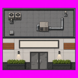](obrazy/sklep_001.webp)

Prompt do opisania obrazu:

```
Describe this image the way you would caption it for an image-generation training dataset.
1. Short caption (one sentence).
2. Detailed caption (one paragraph).
3. Comma-separated tags: art style, viewpoint/projection, type of asset, typical sources where images like this appear.
```

Prompt do wygenerowania obrazu (z opisu modelu 1:1):

```
{Short caption}
Detailed caption: {Detailed caption}
```

| Model opisujący | Opis | gpt-image-2.5-sunburst | gpt-image-2 | nano-banana | grok-imagine-image-2.0 | flux3-klein-destylat | flux2-klein-4b | fibo2-edit-turbo | krea2-turbo | zimage-turbo | moss-sft |
|---|---|---|---|---|---|---|---|---|---|---|---|
| gpt-6-luna | **Short caption:** A pixel-art modern building facade with rooftop ventilation equipment, pipes, a double entrance, wall lights, and planters against a bright magenta background.<br><br>**Detailed caption:** A front-facing, game-style architectural asset depicts a compact modern building divided into an upper gray rooftop or utility section and a lower cream-colored facade. The upper section has square roof tiles, two ventilation units, a small access fixture, and a metal pipe connected to a central utility box. Below it, a blank rectangular sign sits above dark double doors, with wall lights, wooden accent panels, and green shrubs in dark planters on either side. The building is framed by a vivid magenta background.<br><br>**Tags:** pixel art, stylized game art, orthographic front elevation, straight-on view, 2D building facade asset, modular environment sprite, game tileset, indie video game environment, architectural game asset, sprite sheet element, magenta background, rooftop utility equipment, modern storefront entrance | [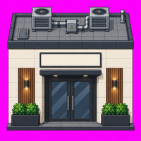](obrazy/sklep_001__gpt-6-luna__short-detailed__gpt-image-2.5-sunburst.webp) | [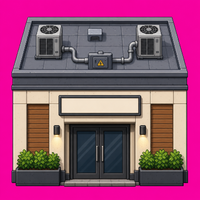](obrazy/sklep_001__gpt-6-luna__short-detailed__gpt-image-2.webp) | [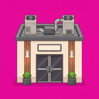](obrazy/sklep_001__gpt-6-luna__short-detailed__nano-banana.webp) | [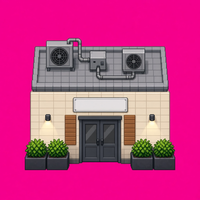](obrazy/sklep_001__gpt-6-luna__short-detailed__grok-imagine-image-2.0.webp) | [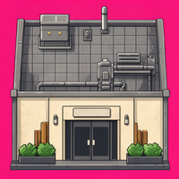](obrazy/sklep_001__gpt-6-luna__short-detailed__flux3-klein-destylat.webp) | [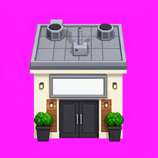](obrazy/sklep_001__gpt-6-luna__short-detailed__flux2-klein-4b.webp) | [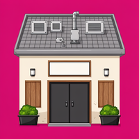](obrazy/sklep_001__gpt-6-luna__short-detailed__fibo2-edit-turbo.webp) | [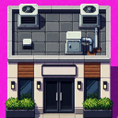](obrazy/sklep_001__gpt-6-luna__short-detailed__krea2-turbo.webp) | [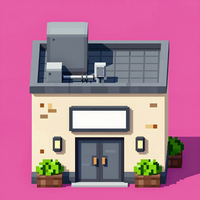](obrazy/sklep_001__gpt-6-luna__short-detailed__zimage-turbo.webp) | [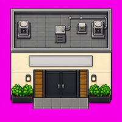](obrazy/sklep_001__gpt-6-luna__short-detailed__moss-sft.webp) |
| gpt-4o | **Short caption:** Top-down view of a stylized building exterior with rooftop elements.<br><br>**Detailed caption:** The image shows a stylized depiction of a building exterior viewed from a top-down perspective. The upper section displays a rooftop with various HVAC units and other utility fixtures set against a tiled surface. Below, the façade features double glass doors framed by wall-mounted lights and decorative wooden panels. Green shrubbery is positioned at the base, adding a touch of nature to the structured design. The background is a vibrant magenta, enhancing the contrast with the building&#x27;s neutral tones.<br><br>**Tags:** pixel art, top-down, building asset, video games, animations, design mockups | [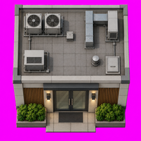](obrazy/sklep_001__gpt-4o__short-detailed__gpt-image-2.5-sunburst.webp) | [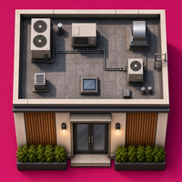](obrazy/sklep_001__gpt-4o__short-detailed__gpt-image-2.webp) | [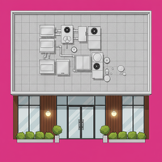](obrazy/sklep_001__gpt-4o__short-detailed__nano-banana.webp) | [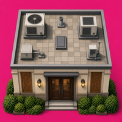](obrazy/sklep_001__gpt-4o__short-detailed__grok-imagine-image-2.0.webp) | [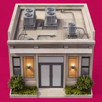](obrazy/sklep_001__gpt-4o__short-detailed__flux3-klein-destylat.webp) | [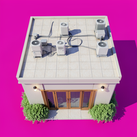](obrazy/sklep_001__gpt-4o__short-detailed__flux2-klein-4b.webp) | [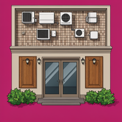](obrazy/sklep_001__gpt-4o__short-detailed__fibo2-edit-turbo.webp) | [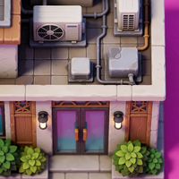](obrazy/sklep_001__gpt-4o__short-detailed__krea2-turbo.webp) | [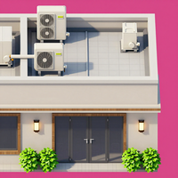](obrazy/sklep_001__gpt-4o__short-detailed__zimage-turbo.webp) | [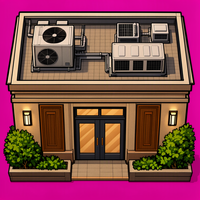](obrazy/sklep_001__gpt-4o__short-detailed__moss-sft.webp) |
| gpt-5 | **Short caption:** Stylized 2D storefront tile with rooftop HVAC, double glass doors, planters, and a blank sign on a magenta transparency background.<br><br>**Detailed caption:** A clean, game-ready building asset showing a modern commercial storefront and its roof in one sprite: the top half is a gray tiled rooftop with vents, two AC condensers, and ductwork; the bottom half is a light concrete facade with dark brick base, centered double metal/glass doors, wall sconces casting cone lights, horizontal wood slats, rectangular planters with green shrubs, and a large empty sign frame. The art uses crisp outlines and subtle shading, presented against a bright magenta matte intended for transparency, suitable for modular environment or tileset use.<br><br>**Tags:** stylized 2D, clean-shaded, semi-realistic, game sprite, orthographic, top-down roof + front elevation, straight-on view, building facade tile, modular environment asset, tileset/spritesheet, city-builder/RPG/simulation game art, indie game assets, mobile/PC game, asset store packs, level editor resources | [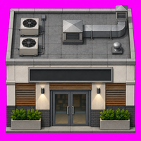](obrazy/sklep_001__gpt-5__short-detailed__gpt-image-2.5-sunburst.webp) | [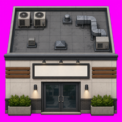](obrazy/sklep_001__gpt-5__short-detailed__gpt-image-2.webp) | [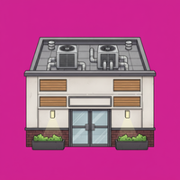](obrazy/sklep_001__gpt-5__short-detailed__nano-banana.webp) | [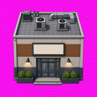](obrazy/sklep_001__gpt-5__short-detailed__grok-imagine-image-2.0.webp) | [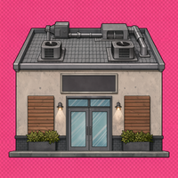](obrazy/sklep_001__gpt-5__short-detailed__flux3-klein-destylat.webp) | [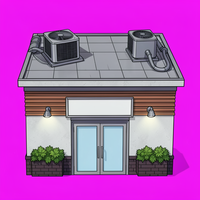](obrazy/sklep_001__gpt-5__short-detailed__flux2-klein-4b.webp) | [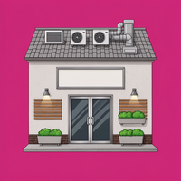](obrazy/sklep_001__gpt-5__short-detailed__fibo2-edit-turbo.webp) | [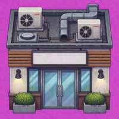](obrazy/sklep_001__gpt-5__short-detailed__krea2-turbo.webp) | [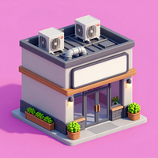](obrazy/sklep_001__gpt-5__short-detailed__zimage-turbo.webp) | [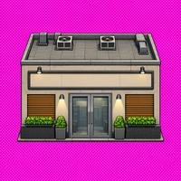](obrazy/sklep_001__gpt-5__short-detailed__moss-sft.webp) |
| gpt-5-mini | **Short caption:** Stylized pixel-art storefront facade with rooftop HVAC units and planter boxes.<br><br>**Detailed caption:** A clean 2D pixel-art depiction of a modern commercial building showing a tiled rooftop with air-conditioning units, vents and a metal duct, above a cream-colored facade featuring a blank rectangular sign panel, horizontal wood accent slats, glass double doors framed in dark trim, wall-mounted sconces casting light onto rectangular planters filled with green shrubs set on a dark brick base; the asset is isolated against a magenta background for use in game or UI layouts.<br><br>**Tags:** pixel art, orthographic front view with top-down rooftop, building facade tileset / 2D game asset, game spritesheets / asset stores / indie 2D games | [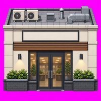](obrazy/sklep_001__gpt-5-mini__short-detailed__gpt-image-2.5-sunburst.webp) | [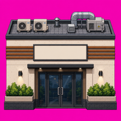](obrazy/sklep_001__gpt-5-mini__short-detailed__gpt-image-2.webp) | [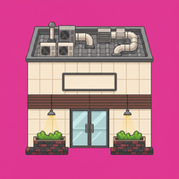](obrazy/sklep_001__gpt-5-mini__short-detailed__nano-banana.webp) | [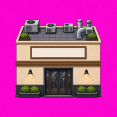](obrazy/sklep_001__gpt-5-mini__short-detailed__grok-imagine-image-2.0.webp) | [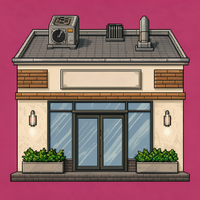](obrazy/sklep_001__gpt-5-mini__short-detailed__flux3-klein-destylat.webp) | [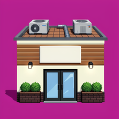](obrazy/sklep_001__gpt-5-mini__short-detailed__flux2-klein-4b.webp) | [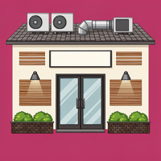](obrazy/sklep_001__gpt-5-mini__short-detailed__fibo2-edit-turbo.webp) | [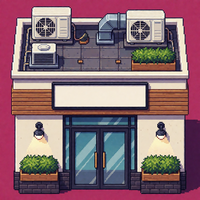](obrazy/sklep_001__gpt-5-mini__short-detailed__krea2-turbo.webp) | [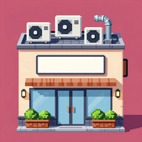](obrazy/sklep_001__gpt-5-mini__short-detailed__zimage-turbo.webp) | [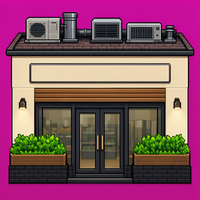](obrazy/sklep_001__gpt-5-mini__short-detailed__moss-sft.webp) |
| gpt-6.1-sol | **Short caption:** A pixel-art commercial building facade with rooftop ventilation equipment, a blank sign, double glass doors, wall lights, and shrub planters against a bright magenta background.<br><br>**Detailed caption:** A square, retro pixel-art building asset shown straight on, with a visible gray tiled rooftop occupying the upper half and a storefront facade below. The roof contains two small fan units at the upper left, a larger central ventilation unit connected to bent silver ductwork extending right, and several small vents. The cream-paneled facade features a wide blank rectangular sign in a dark frame above central gray glass double doors, orange-brown horizontal trim panels at both sides, and two black wall lights casting warm cones of light. Rectangular dark planters filled with dense green shrubs flank the entrance, above a dark brick base. Dark outlines, stepped pixel shading, and subtle shadows define the structure, which is isolated on a vivid solid magenta background.<br><br>**Tags:** pixel art, retro game art, 2D sprite, straight-on elevation, stylized orthographic view, visible rooftop, commercial building facade, storefront exterior, building asset, environment sprite, magenta background, sprite sheets, game asset packs, tilesets, 2D video games, game development marketplaces | [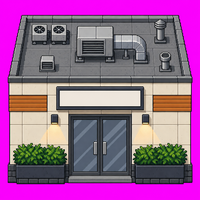](obrazy/sklep_001__gpt-6.1-sol__short-detailed__gpt-image-2.5-sunburst.webp) | [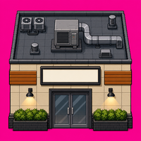](obrazy/sklep_001__gpt-6.1-sol__short-detailed__gpt-image-2.webp) | [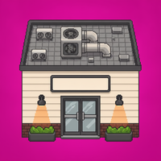](obrazy/sklep_001__gpt-6.1-sol__short-detailed__nano-banana.webp) | [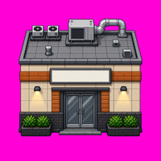](obrazy/sklep_001__gpt-6.1-sol__short-detailed__grok-imagine-image-2.0.webp) | [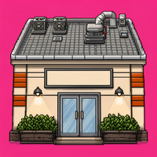](obrazy/sklep_001__gpt-6.1-sol__short-detailed__flux3-klein-destylat.webp) | [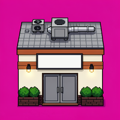](obrazy/sklep_001__gpt-6.1-sol__short-detailed__flux2-klein-4b.webp) | [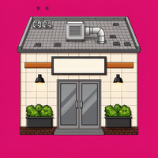](obrazy/sklep_001__gpt-6.1-sol__short-detailed__fibo2-edit-turbo.webp) | [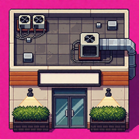](obrazy/sklep_001__gpt-6.1-sol__short-detailed__krea2-turbo.webp) | [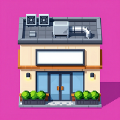](obrazy/sklep_001__gpt-6.1-sol__short-detailed__zimage-turbo.webp) | [](obrazy/sklep_001__gpt-6.1-sol__short-detailed__moss-sft.webp) |
| gemini-3.1-pro-preview | **Short caption:** A split-view pixel art building asset showing a roof and front facade against a magenta background.<br><br>**Detailed caption:** A pixel art graphic of a commercial building separated into two perspectives. The upper portion displays a top-down view of a flat roof equipped with HVAC units, pipes, and vents on gray tiles. The lower portion shows a straight-on front elevation featuring double glass doors, a blank rectangular sign, wall sconces, wood accents, and green planters. The solid magenta background is intended for transparency masking in game development.<br><br>**Tags:** pixel art, top-down, front elevation, orthographic, game asset, building sprite, environment tile, indie game, asset store | [](obrazy/sklep_001__gemini-3.1-pro-preview__short-detailed__gpt-image-2.5-sunburst.webp) | [](obrazy/sklep_001__gemini-3.1-pro-preview__short-detailed__gpt-image-2.webp) | [](obrazy/sklep_001__gemini-3.1-pro-preview__short-detailed__nano-banana.webp) | [](obrazy/sklep_001__gemini-3.1-pro-preview__short-detailed__grok-imagine-image-2.0.webp) | [](obrazy/sklep_001__gemini-3.1-pro-preview__short-detailed__flux3-klein-destylat.webp) | [](obrazy/sklep_001__gemini-3.1-pro-preview__short-detailed__flux2-klein-4b.webp) | [](obrazy/sklep_001__gemini-3.1-pro-preview__short-detailed__fibo2-edit-turbo.webp) | [](obrazy/sklep_001__gemini-3.1-pro-preview__short-detailed__krea2-turbo.webp) | [](obrazy/sklep_001__gemini-3.1-pro-preview__short-detailed__zimage-turbo.webp) | [](obrazy/sklep_001__gemini-3.1-pro-preview__short-detailed__moss-sft.webp) |
| gemini-3.8-flash | **Short caption:** A 2D pixel art building asset featuring a modern storefront entrance below and a flat, tiled rooftop with HVAC units above against a magenta background.<br><br>**Detailed caption:** A 2D game asset depicting a modern commercial building exterior against a solid magenta background. The lower section presents an orthographic storefront with double doors, flanked by brick planters containing green bushes, glowing wall sconces, and wooden panel accents, beneath a large blank rectangular sign. The upper section displays a flat, grey-tiled rooftop equipped with industrial HVAC units, ventilation fans, and metal piping. Rendered in a clean pixel art style with smooth shading, the sprite is suited for top-down or 2.5D urban RPG environments.<br><br>**Tags:** pixel art, orthographic projection, front view, top-down view, 2D game asset, building sprite, tileset, storefront, HVAC rooftop, RPG Maker, game development asset, itch.io | [](obrazy/sklep_001__gemini-3.8-flash__short-detailed__gpt-image-2.5-sunburst.webp) | [](obrazy/sklep_001__gemini-3.8-flash__short-detailed__gpt-image-2.webp) | [](obrazy/sklep_001__gemini-3.8-flash__short-detailed__nano-banana.webp) | [](obrazy/sklep_001__gemini-3.8-flash__short-detailed__grok-imagine-image-2.0.webp) | [](obrazy/sklep_001__gemini-3.8-flash__short-detailed__flux3-klein-destylat.webp) | [](obrazy/sklep_001__gemini-3.8-flash__short-detailed__flux2-klein-4b.webp) | [](obrazy/sklep_001__gemini-3.8-flash__short-detailed__fibo2-edit-turbo.webp) | [](obrazy/sklep_001__gemini-3.8-flash__short-detailed__krea2-turbo.webp) | [](obrazy/sklep_001__gemini-3.8-flash__short-detailed__zimage-turbo.webp) | [](obrazy/sklep_001__gemini-3.8-flash__short-detailed__moss-sft.webp) |
| gemini-3.5-flash-lite | **Short caption:** A pixel art asset showing a modern commercial storefront with a gray roof, empty signboard, and double doors against a magenta background.<br><br>**Detailed caption:** A 2D pixel art game asset depicting the front facade and roof of a modern commercial building, viewed straight-on in an orthographic projection. The image is split horizontally: the top section represents a tiled flat roof populated with various HVAC units, exhaust pipes, and vents. The bottom section shows the building exterior featuring light gray wall panels, dark brickwork at the base, and a pair of metallic double doors at the center. Flanking the entrance are large empty rectangular planter boxes filled with lush green foliage, mounted wall lights casting a downward cone of warm illumination, and decorative wooden slat panels. A large empty horizontal signboard with a dark frame is centered above the doors. The entire sprite is isolated against a bright magenta chroma-key background.<br><br>**Tags:** pixel art, 2D game asset, orthographic projection, front view, storefront sprite, building facade, architectural asset, video game graphics, indie game art, tileable environment asset, RPG maker graphics | [](obrazy/sklep_001__gemini-3.5-flash-lite__short-detailed__gpt-image-2.5-sunburst.webp) | [](obrazy/sklep_001__gemini-3.5-flash-lite__short-detailed__gpt-image-2.webp) | [](obrazy/sklep_001__gemini-3.5-flash-lite__short-detailed__nano-banana.webp) | [](obrazy/sklep_001__gemini-3.5-flash-lite__short-detailed__grok-imagine-image-2.0.webp) | [](obrazy/sklep_001__gemini-3.5-flash-lite__short-detailed__flux3-klein-destylat.webp) | [](obrazy/sklep_001__gemini-3.5-flash-lite__short-detailed__flux2-klein-4b.webp) | [](obrazy/sklep_001__gemini-3.5-flash-lite__short-detailed__fibo2-edit-turbo.webp) | [](obrazy/sklep_001__gemini-3.5-flash-lite__short-detailed__krea2-turbo.webp) | [](obrazy/sklep_001__gemini-3.5-flash-lite__short-detailed__zimage-turbo.webp) | [](obrazy/sklep_001__gemini-3.5-flash-lite__short-detailed__moss-sft.webp) |
| gemini-3-flash-preview | **Short caption:** A pixel art tileset featuring a modern building facade and its rooftop.<br><br>**Detailed caption:** This pixel art asset displays a modern storefront and its corresponding rooftop. The facade includes double doors, a blank rectangular signboard, wood panel accents, and green shrubs in planters. Below the roofline, wall lamps cast light onto a dark brick base. The roof section contains industrial HVAC units, ventilation piping, and square concrete tiles. The graphic is designed for 2D game environments.<br><br>**Tags:** Pixel art, orthographic, tileset, RPG Maker, Itch.io | [](obrazy/sklep_001__gemini-3-flash-preview__short-detailed__gpt-image-2.5-sunburst.webp) | [](obrazy/sklep_001__gemini-3-flash-preview__short-detailed__gpt-image-2.webp) | [](obrazy/sklep_001__gemini-3-flash-preview__short-detailed__nano-banana.webp) | [](obrazy/sklep_001__gemini-3-flash-preview__short-detailed__grok-imagine-image-2.0.webp) | [](obrazy/sklep_001__gemini-3-flash-preview__short-detailed__flux3-klein-destylat.webp) | [](obrazy/sklep_001__gemini-3-flash-preview__short-detailed__flux2-klein-4b.webp) | [](obrazy/sklep_001__gemini-3-flash-preview__short-detailed__fibo2-edit-turbo.webp) | [](obrazy/sklep_001__gemini-3-flash-preview__short-detailed__krea2-turbo.webp) | [](obrazy/sklep_001__gemini-3-flash-preview__short-detailed__zimage-turbo.webp) | [](obrazy/sklep_001__gemini-3-flash-preview__short-detailed__moss-sft.webp) |
| grok-4.7 | **Short caption:** A pixel-art building facade with an industrial upper wall and a storefront entrance below, set against a bright magenta background.<br><br>**Detailed caption:** The front-facing facade is divided horizontally into two sections. The upper half is a gray paneled wall holding two exhaust fans at upper left, a small mounted panel below them, a central utility box connected to metal pipes, and a small fixture at upper right. The lower half is a light beige tiled storefront with brown horizontal slats on both sides, a large blank rectangular sign, dark double doors with silver handles, two illuminated wall sconces, and green shrubs in dark planters along the base.<br><br>**Tags:** pixel art, front-facing orthographic view, building facade asset, video game sprites and asset packs | [](obrazy/sklep_001__grok-4.7__short-detailed__gpt-image-2.5-sunburst.webp) | [](obrazy/sklep_001__grok-4.7__short-detailed__gpt-image-2.webp) | [](obrazy/sklep_001__grok-4.7__short-detailed__nano-banana.webp) | [](obrazy/sklep_001__grok-4.7__short-detailed__grok-imagine-image-2.0.webp) | [](obrazy/sklep_001__grok-4.7__short-detailed__flux3-klein-destylat.webp) | [](obrazy/sklep_001__grok-4.7__short-detailed__flux2-klein-4b.webp) | [](obrazy/sklep_001__grok-4.7__short-detailed__fibo2-edit-turbo.webp) | [](obrazy/sklep_001__grok-4.7__short-detailed__krea2-turbo.webp) | [](obrazy/sklep_001__grok-4.7__short-detailed__zimage-turbo.webp) | [](obrazy/sklep_001__grok-4.7__short-detailed__moss-sft.webp) |
| grok-4.20-0309-reasoning | **Short caption:** Pixel art storefront building facade with rooftop HVAC equipment, blank sign, double glass doors, and planter boxes.<br><br>**Detailed caption:** This 2D pixel art illustration shows the front elevation of a modern commercial building set against a solid magenta background. The upper mechanical floor features a gray tiled wall populated with two large rooftop AC condenser units with visible fans, an electrical box, a small monitor panel, extensive silver ductwork and piping, and a wall-mounted junction box. The lower retail facade consists of white rectangular tiles, horizontal brown wooden slats on both sides of a large blank off-white rectangular sign, two illuminated black wall sconces casting light cones, and a centered set of double glass doors with metallic handles. A dark brick foundation runs along the bottom, interrupted by two identical rectangular planters overflowing with bright green shrubbery positioned symmetrically on either side of the entrance.<br><br>**Tags:** pixel art, orthographic front view, 2d game asset, building facade, storefront exterior, indie game sprite, urban environment, rooftop mechanicals, asset pack, itch.io, game development, digital illustration | [](obrazy/sklep_001__grok-4.20-0309-reasoning__short-detailed__gpt-image-2.5-sunburst.webp) | [](obrazy/sklep_001__grok-4.20-0309-reasoning__short-detailed__gpt-image-2.webp) | [](obrazy/sklep_001__grok-4.20-0309-reasoning__short-detailed__nano-banana.webp) | [](obrazy/sklep_001__grok-4.20-0309-reasoning__short-detailed__grok-imagine-image-2.0.webp) | [](obrazy/sklep_001__grok-4.20-0309-reasoning__short-detailed__flux3-klein-destylat.webp) | [](obrazy/sklep_001__grok-4.20-0309-reasoning__short-detailed__flux2-klein-4b.webp) | [](obrazy/sklep_001__grok-4.20-0309-reasoning__short-detailed__fibo2-edit-turbo.webp) | [](obrazy/sklep_001__grok-4.20-0309-reasoning__short-detailed__krea2-turbo.webp) | [](obrazy/sklep_001__grok-4.20-0309-reasoning__short-detailed__zimage-turbo.webp) | [](obrazy/sklep_001__grok-4.20-0309-reasoning__short-detailed__moss-sft.webp) |
| claude-opus-5-5 | **Short caption:** A pixel-art sprite of a modern commercial building, with a gray HVAC-equipped rooftop drawn from above and a light front facade with glass double doors, on a solid magenta background.<br><br>**Detailed caption:** A game asset of a small modern commercial building in detailed pixel art, drawn in the oblique top-down style common in RPGs. The top half shows the flat roof from above. It has a grid of gray concrete tiles inside a dark parapet border and holds two square air-conditioning condenser units with fans, short vent stacks, a small utility box, and a larger beige HVAC unit connected to bent gray metal pipes. The bottom half shows the front wall straight on. It has off-white panel cladding, a large blank rectangular signboard with a dark frame, and horizontal wood-slat accents on both sides. Two black wall-mounted lamps cast soft cones of warm light downward. A pair of dark-framed tinted glass doors with silver handles sits in the center. Rectangular planters full of bright green shrubs stand on either side, along a dark charcoal brick base. The whole building is isolated on a flat bright magenta (#FF00FF) chroma-key background so it can easily be cut out. The pixel art has clean dark outlines, muted urban colors and subtle shading.<br><br>**Tags:** pixel art, 16-bit style, detailed pixel art, game sprite, clean outlines, muted color palette, top-down view, oblique projection, 3/4 top-down RPG perspective, rooftop seen from above, front elevation facade, orthographic, building sprite, modern commercial building, storefront, shop facade, office entrance, rooftop HVAC, air conditioning units, pipes, blank signboard, glass double doors, wall lamps, planters, shrubs, brick base, tileset asset, isolated object, magenta background, chroma key background, transparent-ready sprite, game asset, environment asset, RPG Maker tileset, top-down RPG game, city builder game, management sim game, indie game asset pack, itch.io asset pack, OpenGameArt, Unity Asset Store, sprite sheet | [](obrazy/sklep_001__claude-opus-5-5__short-detailed__gpt-image-2.5-sunburst.webp) | [](obrazy/sklep_001__claude-opus-5-5__short-detailed__gpt-image-2.webp) | [](obrazy/sklep_001__claude-opus-5-5__short-detailed__nano-banana.webp) | [](obrazy/sklep_001__claude-opus-5-5__short-detailed__grok-imagine-image-2.0.webp) | [](obrazy/sklep_001__claude-opus-5-5__short-detailed__flux3-klein-destylat.webp) | [](obrazy/sklep_001__claude-opus-5-5__short-detailed__flux2-klein-4b.webp) | [](obrazy/sklep_001__claude-opus-5-5__short-detailed__fibo2-edit-turbo.webp) | [](obrazy/sklep_001__claude-opus-5-5__short-detailed__krea2-turbo.webp) | [](obrazy/sklep_001__claude-opus-5-5__short-detailed__zimage-turbo.webp) | [](obrazy/sklep_001__claude-opus-5-5__short-detailed__moss-sft.webp) |
| claude-sonnet-5-5 | **Short caption:** A pixel-art building facade tile showing a flat gray rooftop with HVAC equipment above a modern storefront with a blank sign, double glass doors, wall lamps and planters, on a magenta background.<br><br>**Detailed caption:** This is a 2D pixel-art game asset of a single building seen from a top-down rooftop view stacked above a front-on facade. The upper half is a gray concrete-tiled roof with a dark parapet border. It carries two air-conditioning condenser units with fan grilles at the top left, a small vent unit at the bottom left, and a large beige rooftop HVAC box with a gray metal duct pipe that runs right and bends upward. A small chimney or vent stands in the top right corner. The lower half is a cream and light-gray paneled storefront wall. It has a wide, empty, dark-framed signboard in the center and orange-brown wooden slat panels on both sides. Two black wall-mounted sconce lights cast soft cones of light. The central double glass door has a dark frame and metal handles. Two dark brick planters hold trimmed green hedges. A solid magenta background surrounds the building, which suggests a chroma-key or transparency mask for game use. The palette is muted and neutral, with green and orange accents. The shading is soft and the outlines are dark.<br><br>**Tags:** pixel art, 2D game sprite, modern urban tileset, muted gray palette, hybrid top-down roof and front-facing elevation, orthographic projection, building facade asset, storefront, rooftop HVAC, blank signboard, magenta chroma-key background, game asset sheet, city builder or tycoon game art, indie game asset packs (itch.io, OpenGameArt), AI-generated game asset datasets, Unity/Godot/RPG Maker tilesets | [](obrazy/sklep_001__claude-sonnet-5-5__short-detailed__gpt-image-2.5-sunburst.webp) | [](obrazy/sklep_001__claude-sonnet-5-5__short-detailed__gpt-image-2.webp) | [](obrazy/sklep_001__claude-sonnet-5-5__short-detailed__nano-banana.webp) | [](obrazy/sklep_001__claude-sonnet-5-5__short-detailed__grok-imagine-image-2.0.webp) | [](obrazy/sklep_001__claude-sonnet-5-5__short-detailed__flux3-klein-destylat.webp) | [](obrazy/sklep_001__claude-sonnet-5-5__short-detailed__flux2-klein-4b.webp) | [](obrazy/sklep_001__claude-sonnet-5-5__short-detailed__fibo2-edit-turbo.webp) | [](obrazy/sklep_001__claude-sonnet-5-5__short-detailed__krea2-turbo.webp) | [](obrazy/sklep_001__claude-sonnet-5-5__short-detailed__zimage-turbo.webp) | [](obrazy/sklep_001__claude-sonnet-5-5__short-detailed__moss-sft.webp) |

## Ocena

Ocena każdego obrazu: OK = poprawny rzut od razu, ~ = rzut dobry, ale perspektywa lub tło nie, ✗ = niepoprawny. Punkty: OK = 1, ~ = 0,5.

### Opisy

| Model opisujący | OK | ~ | ✗ | Punkty | Punkty wg sędziego Claude Sonnet 5.5 |
|---|---|---|---|---|---|
| claude-sonnet-5-5 | 3 | 7 | 0 | 6,5 | 5 |
| gpt-6.1-sol | 2 | 8 | 0 | 6 | 5 |
| gpt-5-mini | 0 | 9 | 1 | 4,5 | 3 |
| gpt-5 | 0 | 9 | 1 | 4,5 | 4 |
| gemini-3.5-flash-lite | 0 | 8 | 2 | 4 | 3,5 |
| gpt-6-luna | 2 | 3 | 5 | 3,5 | 4,5 |
| claude-opus-5-5 | 1 | 4 | 5 | 3 | 4 |
| gemini-3.8-flash | 1 | 4 | 5 | 3 | 2,5 |
| gemini-3-flash-preview | 0 | 3 | 7 | 1,5 | 1,5 |
| gpt-4o | 0 | 1 | 9 | 0,5 | 4 |
| gemini-3.1-pro-preview | 0 | 0 | 10 | 0 | 0 |
| grok-4.20-0309-reasoning | 0 | 0 | 10 | 0 | 0 |
| grok-4.7 | 0 | 0 | 10 | 0 | 0 |

### Generatory

| Generator | OK | ~ | ✗ | Punkty | Punkty wg sędziego Claude Sonnet 5.5 |
|---|---|---|---|---|---|
| krea2-turbo | 4 | 3 | 6 | 5,5 | 4 |
| moss-sft | 2 | 6 | 5 | 5 | 4,5 |
| grok-imagine-image-2.0 | 0 | 9 | 4 | 4,5 | 5 |
| nano-banana | 2 | 4 | 7 | 4 | 3,5 |
| flux3-klein-destylat | 0 | 8 | 5 | 4 | 5 |
| gpt-image-2 | 1 | 5 | 7 | 3,5 | 4 |
| fibo2-edit-turbo | 0 | 7 | 6 | 3,5 | 3 |
| flux2-klein-4b | 0 | 5 | 8 | 2,5 | 2,5 |
| gpt-image-2.5-sunburst | 0 | 5 | 8 | 2,5 | 4 |
| zimage-turbo | 0 | 4 | 9 | 2 | 1,5 |

## Część wspólna trzech najlepszych opisów

Opisy z największą liczbą OK: claude-sonnet-5-5, gpt-6.1-sol, gpt-6-luna.

### Propozycja 1: Claude Opus 5.5

**Co się powtarza:**

1. Budynek podzielony na dwie części, góra to dach, dół to front:
   - Sonnet: „The upper half is a gray concrete-tiled roof… The lower half is a… storefront wall”
   - sol: „gray tiled rooftop occupying the upper half and a storefront facade below”
   - luna: „divided into an upper gray rooftop… and a lower cream-colored facade”
2. Widok z przodu nazwany wprost: „front-on facade”, „shown straight on”, „front-facing”. Brak słów „isometric”, „3/4”, „oblique”, „perspective”.
3. Short caption zaczyna się tak samo: „A pixel-art … building facade”; dach jest dodatkiem do fasady.
4. Elementy w tym samym układzie i z położeniem:
   - dach: dwa wentylatory w lewym górnym rogu, większa jednostka w środku, rura w prawo;
   - fasada: pusty szyld → podwójne drzwi → kinkiety → drewniane panele po bokach → donice z krzewami → ciemny cokół.
5. Tło: „vivid / bright / solid magenta”.

**W opisach, które dały same ✗ albo prawie same:**

- gpt-4o: „viewed from a top-down perspective” → widok 3/4;
- grok-4.7 i grok-4.20: góra nazwana ścianą („industrial upper wall”, „upper mechanical floor”);
- gemini-3.1-pro-preview: „split-view… two perspectives” → dwa osobne kawałki;
- gemini-3-flash-preview: „tileset” → arkusz elementów.

**Szkielet:**

```
A pixel-art [building] facade with [rooftop equipment] above [front elements], on a vivid magenta background.
A [game asset] of a single building shown straight on: the upper half is a [flat roof seen from above: surface + equipment with positions], the lower half is the front facade [elements left to right]. [colours, outlines], isolated on a solid magenta background.
```

### Propozycja 2: Claude Sonnet 5.5

Podagent dostał tylko ten README, bez innych informacji.

**Co się powtarza:**

- Początek: styl i rodzaj zasobu, zaraz potem rzut: luna „front-facing, game-style architectural asset”, sol „square, retro pixel-art building asset shown straight on”, sonnet „2D pixel-art game asset of a single building”.
- Kolejność od góry do dołu: dach (gray tiled rooftop, jednostki wentylacyjne, rura) → fasada (pusty szyld, drzwi, lampy, drewniane panele, donice) → tło jako osobne zdanie o izolacji.
- Słowa we wszystkich trzech: pixel-art, magenta, rooftop / ventilation / HVAC, „blank … sign” nad „double … doors”, „wall lights”, „green shrubs” / „hedges” w ciemnych donicach, „dark brick base”.
- Konkret zamiast ogólników: liczby, pozycje i kolory („two small fan units at the upper left”, „a larger central ventilation unit connected to bent silver ductwork”).
- Dach jako część jednego budynku: luna i sol nie używają „top-down”; piszą „straight-on”, „front elevation”, „visible rooftop”. Sonnet jako jedyny pisze „top-down rooftop view stacked above a front-on facade”.

**W opisach, które wypadły najgorzej:**

- rozbicie na dwa rzuty: gemini-3.1 „split-view”, „two perspectives”; gpt-4o „Top-down view of a stylized building exterior”;
- dach opisany jako ściana lub piętro: grok-4.7 „industrial upper wall”, grok-4.20 „upper mechanical floor”, „gray tiled wall”;
- brak zdania o izolacji na jednolitej magencie;
- mało jednoznacznych słów kluczowych.

**Szkielet:**

```
Pixel-art game asset of a [typ budynku, np. modern commercial building], shown straight-on
in a single flat front elevation, isolated on a solid bright magenta (#FF00FF) background.

Upper section: the building's flat gray tiled rooftop, drawn as part of the same flat image
(not a separate view), with [liczba] [rodzaj urządzeń, np. air-conditioning units] at the
[pozycja], a [duża jednostka] at the center connected to bent [kolor] metal pipes, [drobne elementy].

Lower section: [kolor/materiał] facade with a wide blank rectangular sign in a dark frame
centered above [kolor] double glass doors with metal handles; [liczba] black wall-mounted
lights casting soft cones of warm light; [kolor] horizontal wood-slat panels on both sides;
rectangular dark planters with dense green shrubs on either side, above a dark brick base.

Style: clean dark outlines, soft stepped shading, muted palette with green and orange accents.
Entire building fills the frame, centered, nothing else in the image.
```

Zasady: rzut raz, jako „straight-on front elevation”, bez „top-down” i „split”; dach nazwany wprost („rooftop”) w „upper section”; elementy od góry do dołu z liczbami, kolorami i pozycjami; tło jednym zdaniem z konkretnym kolorem; bez tagów typu tileset, sprite sheet, itch.io.
