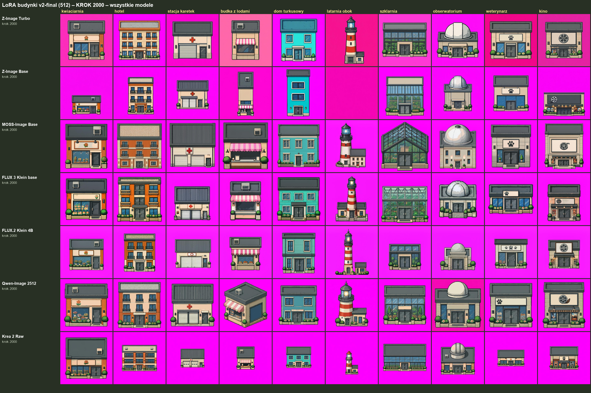

# LoRA budynki v2-final

Zbiór: [`../../zbiory/v2-final/`](../../zbiory/v2-final/) (te same 72 budynki co v1, ciasny kadr, rozmiar w metrach w opisie). Pliki LoRA: Hugging Face [`budynki/v2/`](https://huggingface.co/q3ok/dioramaonline-lora-models/tree/main/budynki/v2), wszystkie kroki 250–2000; w każdym folderze `config_ai-toolkit.yaml`.

Trening: ai-toolkit (ostris), RunPod, 512 px, bf16, rank 16, alpha 16, lr 1e-4, 2000 kroków, zapis co 250, podgląd co 500. Karty 48 GB (A6000 / A40 / L40), Qwen na A100 80 GB. Wszystkie 7 równolegle, każdy na osobnej maszynie. Słowo wyzwalające: `swiat2d style`.

| model bazowy | do użycia też na | licencja | HF |
|---|---|---|---|
| Z-Image Turbo | – | Apache 2.0 | [zimage-turbo-512](https://huggingface.co/q3ok/dioramaonline-lora-models/tree/main/budynki/v2/zimage-turbo-512) |
| Z-Image Base | (nie działa na Turbo) | Apache 2.0 | [zimage-base-512](https://huggingface.co/q3ok/dioramaonline-lora-models/tree/main/budynki/v2/zimage-base-512) |
| MOSS-Image Base | MOSS-Image SFT | Apache 2.0 | [moss-image-base-512](https://huggingface.co/q3ok/dioramaonline-lora-models/tree/main/budynki/v2/moss-image-base-512) |
| FLUX 3 Image Klein base | FLUX 3 Klein destylat | FLUX Kommunity | [flux3-klein-base-512](https://huggingface.co/q3ok/dioramaonline-lora-models/tree/main/budynki/v2/flux3-klein-base-512) |
| FLUX.2 Klein 4B base | FLUX.2 Klein 4B destylat | Apache 2.0 | [flux2-klein-4b-512](https://huggingface.co/q3ok/dioramaonline-lora-models/tree/main/budynki/v2/flux2-klein-4b-512) |
| Qwen-Image 2512 | – | Apache 2.0 | [qwen-image-2512-512](https://huggingface.co/q3ok/dioramaonline-lora-models/tree/main/budynki/v2/qwen-image-2512-512) |
| Krea 2 Raw | Krea 2 Turbo (int8 lokalnie) | Krea 2 Community (LICENSE + NOTICE w folderze) | [krea2-raw-512](https://huggingface.co/q3ok/dioramaonline-lora-models/tree/main/budynki/v2/krea2-raw-512) |

Qwen-Image-Edit 2511 wykluczony z v2: trening ok. 3 h na A100, lokalnie tylko Q4 ok. 5,5 min na obraz, w v1 wynik średni (9–12 pkt z 20). Trening v2 przerwany na kroku ~630.

Wyniki: [`../../porownania/2026-10-21_lora-v2_prompty-v2/`](../../porownania/2026-10-21_lora-v2_prompty-v2/).

## Podglądy z treningu (prompty v2, seed 42+i)

Krok 0 (bez LoRA): [`podglady/krok_0.png`](podglady/krok_0.png) · krok 1000: [`podglady/krok_1000.png`](podglady/krok_1000.png)

Krok 2000:

