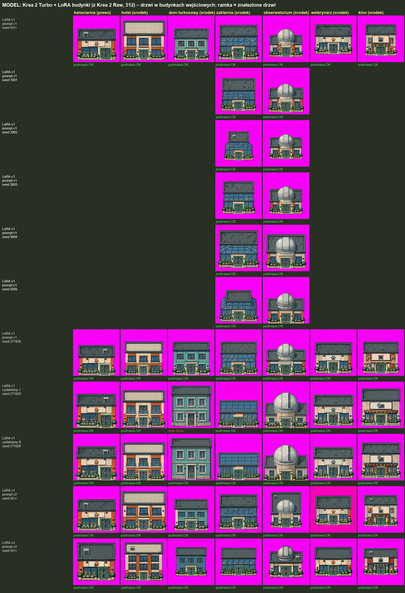

# Drzwi w budynkach wejściowych: Krea 2 Turbo (2026-10-21)

Czy we wszystkich wygenerowanych budynkach wejściowych z Krea 2 Turbo + LoRA budynki (z Krea 2 Raw, 512) da się podmienić drzwi na kanoniczne drzwi gry (std-external-2)?

- 52 obrazy, 7 budynków wejściowych:
  - LoRA v1 + prompty v1: seed 42+i, nowe seedy 1001–5005 (tylko szklarnia i obserwatorium), seed 271828;
  - uzdatnione J i K (seed 271828);
  - LoRA v1 + prompty v2;
  - LoRA v2 + prompty v2.
- Automatycznie: dopasowanie wzorca drzwi (skala 0,5–4×, bo w v2 budynek wypełnia kadr), położenie zgodne z promptem (środek / prawo), dół drzwi na linii gruntu.
- Ręcznie: każde dopasowanie obejrzane w powiększeniu ([`powiekszenia.png`](powiekszenia.png)).

## Wynik
**50 z 52: drzwi kanoniczne (ciemne, dwuskrzydłowe), we właściwym miejscu i na ziemi – podmiana możliwa.**
- We wszystkich zestawach z promptem v1 lub v2, przy LoRA v1 i v2, drzwi są w 100% poprawne.
- Wyjątek: dom turkusowy z uzdatnionym promptem **J** i **K** ma pojedyncze wysokie drzwi z naświetlem. Hasło „realistic” / „semi-realistic” zmienia styl drzwi. Automat złapał tylko J; przy K ramka objęła dolną połowę pojedynczych drzwi (fałszywe trafienie, poprawione ręcznie w CSV).

Wniosek: Krea 2 Turbo z naszą LoRA trzyma kanoniczne drzwi niemal zawsze. Przy uzdatnionych promptach trzeba dopisać drzwi wprost (np. „the standard dark double entrance door”).

Pliki: [`drzwi.csv`](drzwi.csv) – wynik automatu + kolumna `sprawdzone_recznie`.
