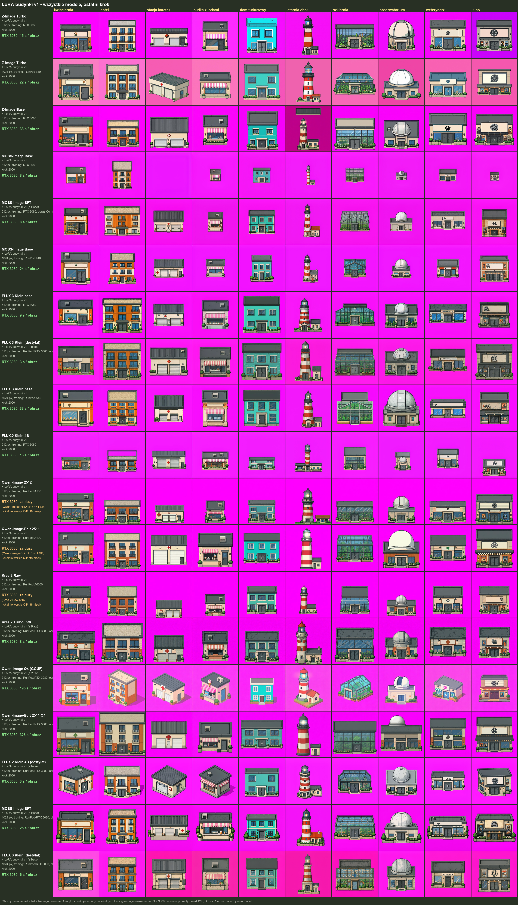
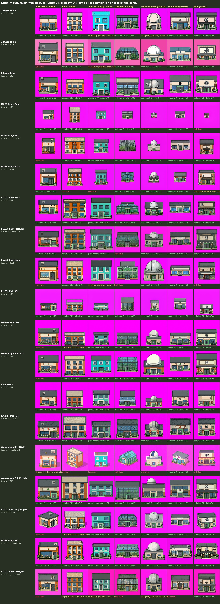

# LoRA v1 na promptach v1 (2026-10-21)

- Wiersz: model bazowy + LoRA budynki v1 + rozdzielczość. Kolumna: budynek testowy ([prompty v1](../../testy/prompty_v1.json)). Opisy LoRA: [`../../modele/v1/`](../../modele/v1/).
- Obrazy: podgląd z treningu (ai-toolkit, krok 2000, seed 42+i), a gdzie go nie było lub LoRA użyta na innej wersji modelu – ComfyUI na RTX 3080, ten sam prompt i seed.
- Czas RTX 3080: jeden obraz po wczytaniu modelu. „Za duży”: model w pełnej precyzji nie mieści się w 10 GB VRAM + 32 GB RAM.
- Prompty v1 mają dwa znane błędy: „a small side door” przy stacji karetek i zaprzeczenie przy budce z lodami (poprawione w v2).

## Ranking

Oceny właściciela: każdy z 10 budynków testowych w każdym wierszu oznaczony jako dobre / średnie / słabe. Punkty: dobre 2, średnie 1, słabe 0 (maks. 20).

| # | model | LoRA, rozdzielczość | trening LoRA / generowanie obrazu | punkty | dobre | średnie | słabe | RTX 3080 / obraz |
|---|---|---|---|---|---|---|---|---|
| 1 | Z-Image Turbo | budynki v1, 512 px | RTX 3080 | **15** | 6 | 3 | 1 | 15 s |
| 2 | MOSS-Image SFT | budynki v1 (z Base), 1024 px | RunPod/RTX 3080, obraz ComfyUI | **15** | 6 | 3 | 1 | 25 s |
| 3 | Krea 2 Turbo int8 | budynki v1 (z Raw), 512 px | RunPod/RTX 3080, obraz ComfyUI | **15** | 5 | 5 | 0 | 8.2 s |
| 4 | Krea 2 Raw | budynki v1, 512 px | RunPod A6000 | **14** | 6 | 2 | 2 | za duży |
| 5 | FLUX 3 Klein (destylat) | budynki v1 (z base), 512 px | RunPod/RTX 3080, obraz ComfyUI | **12** | 5 | 2 | 3 | 2.6 s |
| 6 | Qwen-Image-Edit 2511 Q4 | budynki v1, 512 px | RunPod/RTX 3080, obraz ComfyUI | **12** | 5 | 2 | 3 | 326 s |
| 7 | MOSS-Image SFT | budynki v1 (z Base), 512 px | RTX 3080, obraz ComfyUI | **12** | 4 | 4 | 2 | 7.7 s |
| 8 | MOSS-Image Base | budynki v1, 1024 px | RunPod L40 | **12** | 4 | 4 | 2 | 24 s |
| 9 | Z-Image Turbo | budynki v1, 1024 px | RunPod L40 | **11** | 5 | 1 | 4 | 22 s |
| 10 | Z-Image Base | budynki v1, 512 px | RTX 3080 | **10** | 4 | 2 | 4 | 33 s |
| 11 | FLUX 3 Klein base | budynki v1, 512 px | RTX 3080 | **9** | 3 | 3 | 4 | 8.7 s |
| 12 | Qwen-Image-Edit 2511 | budynki v1, 512 px | RunPod A100 | **9** | 3 | 3 | 4 | za duży |
| 13 | FLUX 3 Klein base | budynki v1, 1024 px | RunPod A40 | **7** | 0 | 7 | 3 | 33 s |
| 14 | Qwen-Image 2512 | budynki v1, 512 px | RunPod A100 | **6** | 2 | 2 | 6 | za duży |
| 15 | MOSS-Image Base | budynki v1, 512 px | RTX 3080 | **6** | 0 | 6 | 4 | 7.8 s |
| 16 | FLUX 3 Klein (destylat) | budynki v1 (z base), 1024 px | RunPod/RTX 3080, obraz ComfyUI | **5** | 1 | 3 | 6 | 6.3 s |
| 17 | FLUX.2 Klein 4B | budynki v1, 512 px | RTX 3080 | **4** | 1 | 2 | 7 | 16 s |
| 18 | FLUX.2 Klein 4B (destylat) | budynki v1 (z base), 512 px | RunPod/RTX 3080, obraz ComfyUI | **3** | 1 | 1 | 8 | 3.1 s |
| 19 | Qwen-Image Q4 (GGUF) | budynki v1 (z 2512), 512 px | RunPod/RTX 3080, obraz ComfyUI | **0** | 0 | 0 | 10 | 195 s |

## Budynki: które modele narysowały je dobrze

| budynek | dobre | średnie | słabe | oceniony jako „dobre” u |
|---|---|---|---|---|
| kwiaciarnia | 8 | 1 | 10 | Z-Image Turbo (512 px), Krea 2 Turbo int8 (512 px), Krea 2 Raw (512 px), FLUX 3 Klein (destylat) (512 px), Qwen-Image-Edit 2511 Q4 (512 px), MOSS-Image Base (1024 px), Z-Image Base (512 px), FLUX 3 Klein base (512 px) |
| hotel | 10 | 5 | 4 | Z-Image Turbo (512 px), MOSS-Image SFT (1024 px), Krea 2 Turbo int8 (512 px), Krea 2 Raw (512 px), FLUX 3 Klein (destylat) (512 px), Qwen-Image-Edit 2511 Q4 (512 px), MOSS-Image SFT (512 px), Z-Image Turbo (1024 px), Z-Image Base (512 px), Qwen-Image-Edit 2511 (512 px) |
| stacja karetek | 7 | 7 | 5 | Z-Image Turbo (512 px), MOSS-Image SFT (1024 px), Krea 2 Raw (512 px), FLUX 3 Klein (destylat) (512 px), MOSS-Image SFT (512 px), FLUX 3 Klein (destylat) (1024 px), FLUX.2 Klein 4B (512 px) |
| budka z lodami | 8 | 4 | 7 | MOSS-Image SFT (1024 px), Krea 2 Raw (512 px), FLUX 3 Klein (destylat) (512 px), MOSS-Image SFT (512 px), MOSS-Image Base (1024 px), Z-Image Turbo (1024 px), Z-Image Base (512 px), FLUX 3 Klein base (512 px) |
| dom turkusowy | 11 | 2 | 6 | Z-Image Turbo (512 px), MOSS-Image SFT (1024 px), Krea 2 Turbo int8 (512 px), Krea 2 Raw (512 px), FLUX 3 Klein (destylat) (512 px), Qwen-Image-Edit 2511 Q4 (512 px), MOSS-Image SFT (512 px), Z-Image Turbo (1024 px), Z-Image Base (512 px), FLUX 3 Klein base (512 px), Qwen-Image-Edit 2511 (512 px) |
| latarnia z domkiem | 0 | 6 | 13 | – |
| szklarnia | 4 | 6 | 9 | MOSS-Image SFT (1024 px), MOSS-Image Base (1024 px), Qwen-Image-Edit 2511 (512 px), FLUX.2 Klein 4B (destylat) (512 px) |
| obserwatorium | 1 | 10 | 8 | Z-Image Turbo (1024 px) |
| weterynarz | 7 | 7 | 5 | Z-Image Turbo (512 px), Krea 2 Turbo int8 (512 px), Krea 2 Raw (512 px), Qwen-Image-Edit 2511 Q4 (512 px), MOSS-Image Base (1024 px), Z-Image Turbo (1024 px), Qwen-Image 2512 (512 px) |
| kino | 5 | 7 | 7 | Z-Image Turbo (512 px), MOSS-Image SFT (1024 px), Krea 2 Turbo int8 (512 px), Qwen-Image-Edit 2511 Q4 (512 px), Qwen-Image 2512 (512 px) |

## Drzwi w budynkach wejściowych

Automatyczne wyszukanie kanonicznych drzwi gry (std-external-2) w 7 budynkach wejściowych każdego wiersza (133 obrazów): 101 – drzwi w miejscu z promptu i na linii gruntu (podmiana możliwa), 11 – inne położenie lub nad gruntem, 21 – brak drzwi. Rozmiar nie blokuje podmiany: budynek skaluje się tak, żeby drzwi miały 58 px. Wyniki per obraz: [`drzwi.csv`](drzwi.csv). Wykrywanie automatyczne – może się mylić (np. trafić w okno).

Pliki: [`oceny.csv`](oceny.csv) – ocena każdego obrazu.
