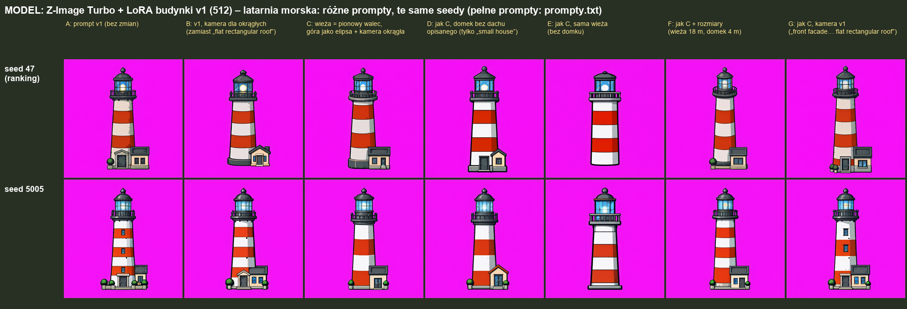
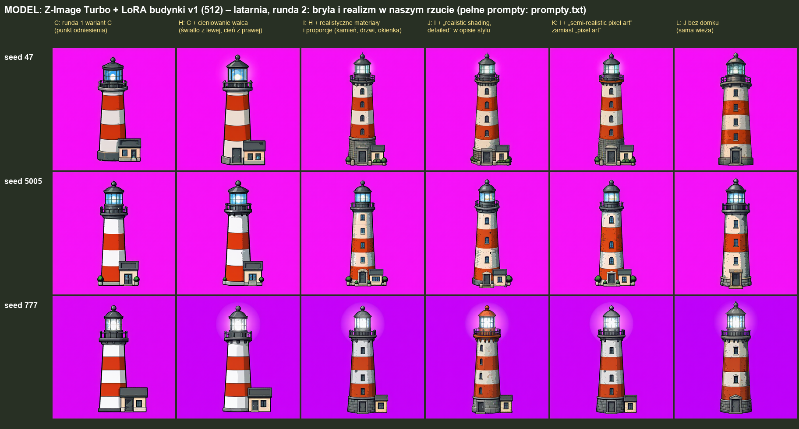
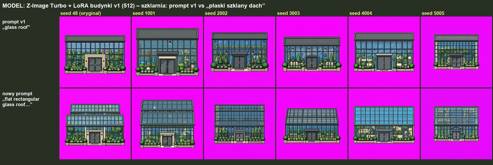

# Latarnia morska, szklany dach i realistyczne cieniowanie (2026-10-21)

Model: **Z-Image Turbo + LoRA budynki v1 (512)**, ComfyUI na RTX 3080, 8 kroków, cfg 1. Prompty testowe v1 z [rankingu](../) jako punkt wyjścia.
Ocena obrazów: właściciel projektu.

Powód testu: w rankingu v1 latarnia była najsłabszym budynkiem (0 ocen „dobre” na 19 modeli), a zbiór v1-final nie ma żadnego okrągłego obiektu. Końcówka promptu („front facade facing the viewer, flat rectangular roof visible from above”) jest pisana pod prostopadłościany.

## Runda 1: kamera i opis bryły

Te same seedy (47 – seed z rankingu, 5005), 7 wariantów promptu ([`runda1-kamera/prompty.txt`](runda1-kamera/prompty.txt)):

| wariant | zmiana |
|---|---|
| A | prompt v1 bez zmian |
| B | końcówka kamery dla okrągłych: „seen from the south and slightly from above, round shapes drawn straight from the front with vertical sides and their tops visible as flattened ellipses” zamiast „flat rectangular roof” |
| C | B + wieża opisana jako „straight vertical cylinder”, góra jako „flattened ellipse”, domek „with a dark grey flat roof” |
| D | C, domek bez opisu dachu |
| E | C, sama wieża bez domku |
| F | C + rozmiary (wieża ok. 18 m, domek ok. 4 m) |
| G | C z kamerą v1 |

Obserwacje:
- Wieża wychodzi prawie tak samo we wszystkich wariantach – zmiana kamery i opis walca nie zmieniają jej kształtu.
- Zmienia się domek: bez opisu dachu (A, B, D) dostaje dach spadzisty; płaski dach pojawia się dopiero po dopisaniu „with a dark grey flat roof”.

## Runda 2: bryła i realizm w naszym rzucie

Baza: wariant C. Seedy 47, 5005, 777 ([`runda2-realizm/prompty.txt`](runda2-realizm/prompty.txt)):

| wariant | zmiana |
|---|---|
| C | punkt odniesienia z rundy 1 |
| H | + cieniowanie walca: światło z lewej u góry, ciemniej ku prawej krawędzi |
| I | H + materiały i proporcje: kamienne bloki, zniszczona farba, kamienny cokół z drzwiami, okienka po wysokości wieży |
| **J** | I + w opisie stylu „Detailed pixel art game sprite with realistic shading and volume” |
| **K** | I + „Semi-realistic pixel art game sprite” zamiast „Pixel art game sprite” |
| L | J bez domku |

Ocena właściciela: **najlepsze latarnie dają J („realistic shading”) i K („semi-realistic pixel art”)**; pozostałe warianty nadal słabe.

Obserwacje:
- Samo cieniowanie walca (H) prawie nic nie zmienia.
- Dopiero opis materiałów razem z hasłem stylu (J, K) daje bryłę, teksturę kamienia, cokół, drzwi i okienka – nadal w naszym rzucie i jako pixel art.
- Seed 777 przy H, I, K daje poświatę wokół latarni i fioletowe tło zamiast magenty.

## Szklarnia: płaski szklany dach

Prompt v1 („large glass walls and a glass roof”) daje ciemnoszary pasek dachu jak w innych budynkach – szkło tylko w ścianach.
Nowy prompt ([`szklarnia-dach/prompty.txt`](szklarnia-dach/prompty.txt)): „a flat rectangular glass roof made of glass panels in a metal frame, seen from above like the flat roofs of the other buildings, green plants visible through the glass walls and the glass roof”.
- Dach staje się szklany (tafle w ramie). Część seedów (48, 1001, 3003) dodaje drugi, stopniowany poziom dachu; 4004 daje dach niebieski jak niebo.
- Ocena właściciela: seed 5005 – całkiem dobra szklarnia (wnętrze widoczne przez szyby nie idealne).

## Wnioski do promptów

- Dla obiektów spoza zbioru (okrągłe, wysokie, szklane) pomaga opis materiałów + hasło stylu „realistic shading and volume” / „semi-realistic pixel art”. Do sprawdzenia na pozostałych słabych budynkach.
- Dach budynku towarzyszącego trzeba opisać wprost („with a dark grey flat roof”), inaczej model rysuje spadzisty.
- Szklany dach trzeba opisać jako płaski prostokąt z tafli w ramie, inaczej model daje zwykły dach-pasek.
- Zbiory v1-final i v2-final nie mają okrągłych obiektów ani szklanych dachów – kandydaci do kolejnego zbioru.
