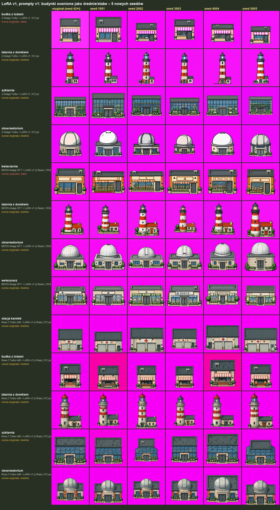

# LoRA v1, prompty v1 – nowe seedy dla słabszych budynków (2026-10-21)

Trzy najlepsze wiersze rankingu [LoRA v1 na promptach v1](../) (po 15 pkt): Z-Image Turbo 512, MOSS-Image SFT 1024 (LoRA z Base), Krea 2 Turbo int8 512 (LoRA z Raw).
Każdy budynek, który w rankingu dostał ocenę średnie lub słabe, wygenerowany ponownie z 5 nowymi seedami (1001, 2002, 3003, 4004, 5005; w rankingu był seed 42+i). Ten sam prompt v1, LoRA i ustawienia; ComfyUI na RTX 3080.
Oceny właściciela: dobre / średnie / słabe (oryginał oceniony ponownie razem z nowymi wersjami).

## Oceny

| model | budynek | ocena w rankingu | oryginał (ponownie) | 1001 | 2002 | 3003 | 4004 | 5005 | dobre z 5 nowych |
|---|---|---|---|---|---|---|---|---|---|
| Z-Image Turbo (512 px) | budka z lodami | słabe | słabe | słabe | średnie | słabe | słabe | dobre | 1 |
| Z-Image Turbo (512 px) | latarnia z domkiem | średnie | słabe | słabe | słabe | średnie | słabe | słabe | 0 |
| Z-Image Turbo (512 px) | szklarnia | średnie | średnie | słabe | średnie | średnie | średnie | średnie | 0 |
| Z-Image Turbo (512 px) | obserwatorium | średnie | średnie | dobre | słabe | średnie | średnie | dobre | 2 |
| MOSS-Image SFT (1024 px) | kwiaciarnia | słabe | słabe | słabe | słabe | słabe | słabe | słabe | 0 |
| MOSS-Image SFT (1024 px) | latarnia z domkiem | średnie | średnie | średnie | średnie | słabe | średnie | średnie | 0 |
| MOSS-Image SFT (1024 px) | obserwatorium | średnie | słabe | słabe | słabe | słabe | średnie | słabe | 0 |
| MOSS-Image SFT (1024 px) | weterynarz | średnie | słabe | słabe | słabe | słabe | słabe | średnie | 0 |
| Krea 2 Turbo int8 (512 px) | stacja karetek | średnie | średnie | średnie | średnie | średnie | dobre | dobre | 2 |
| Krea 2 Turbo int8 (512 px) | budka z lodami | średnie | słabe | słabe | słabe | słabe | słabe | średnie | 0 |
| Krea 2 Turbo int8 (512 px) | latarnia z domkiem | średnie | dobre | średnie | średnie | średnie | średnie | średnie | 0 |
| Krea 2 Turbo int8 (512 px) | szklarnia | średnie | słabe | słabe | słabe | słabe | słabe | słabe | 0 |
| Krea 2 Turbo int8 (512 px) | obserwatorium | średnie | dobre | dobre | dobre | dobre | dobre | dobre | 5 |

Nowe seedy: 10 z 65 ocenionych obrazów dobrych.

| budynek | dobre z nowych seedów (wszystkie 3 modele) |
|---|---|
| kwiaciarnia | 0 z 5 |
| stacja karetek | 2 z 5 |
| budka z lodami | 1 z 10 |
| latarnia z domkiem | 0 z 15 |
| szklarnia | 0 z 10 |
| obserwatorium | 7 z 15 |
| weterynarz | 0 z 5 |

Obrazy: [`obrazy/`](obrazy/) (`<model>_<budynek>_seed<N>.jpg`). Oceny: [`oceny.csv`](oceny.csv).
