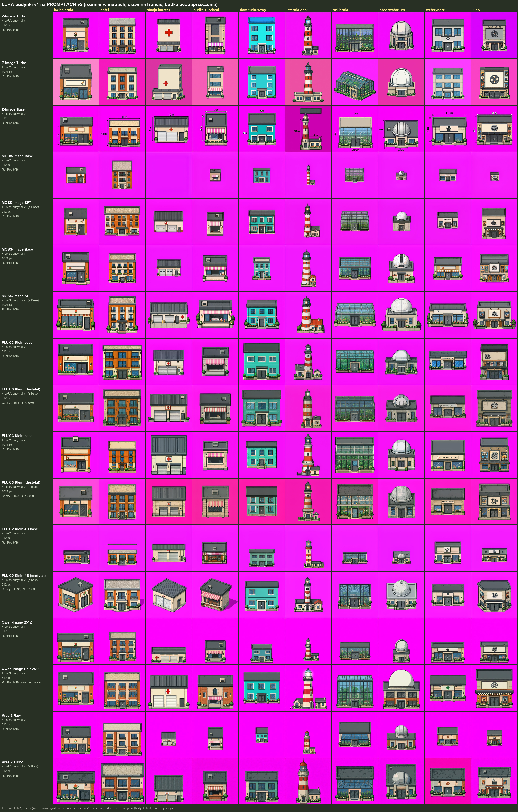

# LoRA v1 na promptach v2 (2026-10-21)

- Te same LoRA v1, seedy i ustawienia co w [porównaniu na promptach v1](../2026-10-21_lora-v1_prompty-v1/); zmieniony tylko tekst promptów ([prompty v2](../../testy/prompty_v2.json): rozmiar w metrach, drzwi stacji karetek na froncie, budka bez zaprzeczenia).
- Obrazy: RunPod (ai-toolkit, bf16, LoRA wczytana, bez uczenia); FLUX 3 i FLUX.2 Klein w wersji destylowanej – ComfyUI na RTX 3080 (ai-toolkit ich nie wczytuje).
- LoRA v1 nie widziała w opisach rozmiarów w metrach – to test samych promptów, nie zbioru v2.

## Ranking

Oceny właściciela: każdy z 10 budynków testowych w każdym wierszu oznaczony jako dobre / średnie / słabe. Punkty: dobre 2, średnie 1, słabe 0 (maks. 20).

| # | model | LoRA, rozdzielczość | trening LoRA / generowanie obrazu | punkty | dobre | średnie | słabe |
|---|---|---|---|---|---|---|---|
| 1 | Qwen-Image 2512 | budynki v1, 512 px | RunPod bf16 | **13** | 5 | 3 | 2 |
| 2 | Z-Image Turbo | budynki v1, 512 px | RunPod bf16 | **12** | 5 | 2 | 3 |
| 3 | Krea 2 Turbo | budynki v1 (z Raw), 512 px | RunPod bf16 | **12** | 4 | 4 | 2 |
| 4 | MOSS-Image SFT | budynki v1 (z Base), 512 px | RunPod bf16 | **11** | 3 | 5 | 2 |
| 5 | MOSS-Image Base | budynki v1, 1024 px | RunPod bf16 | **11** | 3 | 5 | 2 |
| 6 | FLUX 3 Klein base | budynki v1, 512 px | RunPod bf16 | **11** | 3 | 5 | 2 |
| 7 | MOSS-Image SFT | budynki v1 (z Base), 1024 px | RunPod bf16 | **10** | 3 | 4 | 3 |
| 8 | FLUX 3 Klein (destylat) | budynki v1 (z base), 1024 px | ComfyUI int8, RTX 3080 | **9** | 3 | 3 | 4 |
| 9 | Qwen-Image-Edit 2511 | budynki v1, 512 px | RunPod bf16, wzór jako obraz | **9** | 3 | 3 | 4 |
| 10 | FLUX 3 Klein (destylat) | budynki v1 (z base), 512 px | ComfyUI int8, RTX 3080 | **9** | 2 | 5 | 3 |
| 11 | Krea 2 Raw | budynki v1, 512 px | RunPod bf16 | **9** | 2 | 5 | 3 |
| 12 | FLUX 3 Klein base | budynki v1, 1024 px | RunPod bf16 | **7** | 2 | 3 | 5 |
| 13 | FLUX.2 Klein 4B (destylat) | budynki v1 (z base), 512 px | ComfyUI bf16, RTX 3080 | **6** | 3 | 0 | 7 |
| 14 | Z-Image Turbo | budynki v1, 1024 px | RunPod bf16 | **5** | 1 | 3 | 6 |
| 15 | FLUX.2 Klein 4B base | budynki v1, 512 px | RunPod bf16 | **4** | 2 | 0 | 8 |
| 16 | MOSS-Image Base | budynki v1, 512 px | RunPod bf16 | **1** | 0 | 1 | 9 |
| 17 | Z-Image Base | budynki v1, 512 px | RunPod bf16 | **0** | 0 | 0 | 10 |

## Budynki: które modele narysowały je dobrze

| budynek | dobre | średnie | słabe | oceniony jako „dobre” u |
|---|---|---|---|---|
| kwiaciarnia | 2 | 6 | 9 | Krea 2 Turbo (512 px), FLUX.2 Klein 4B base (512 px) |
| hotel | 10 | 1 | 6 | Z-Image Turbo (512 px), Krea 2 Turbo (512 px), MOSS-Image SFT (512 px), FLUX 3 Klein base (512 px), MOSS-Image SFT (1024 px), FLUX 3 Klein (destylat) (1024 px), Qwen-Image-Edit 2511 (512 px), FLUX 3 Klein (destylat) (512 px), Krea 2 Raw (512 px), Z-Image Turbo (1024 px) |
| stacja karetek | 0 | 10 | 7 | – |
| budka z lodami | 2 | 7 | 8 | MOSS-Image Base (1024 px), MOSS-Image SFT (1024 px) |
| dom turkusowy | 6 | 5 | 6 | Qwen-Image 2512 (512 px), Z-Image Turbo (512 px), Krea 2 Turbo (512 px), MOSS-Image SFT (512 px), FLUX 3 Klein base (512 px), FLUX.2 Klein 4B (destylat) (512 px) |
| latarnia z domkiem | 4 | 5 | 8 | Qwen-Image 2512 (512 px), Z-Image Turbo (512 px), FLUX.2 Klein 4B (destylat) (512 px), FLUX.2 Klein 4B base (512 px) |
| szklarnia | 4 | 5 | 8 | MOSS-Image SFT (512 px), MOSS-Image Base (1024 px), FLUX 3 Klein base (512 px), Qwen-Image-Edit 2511 (512 px) |
| obserwatorium | 6 | 5 | 6 | Qwen-Image 2512 (512 px), Z-Image Turbo (512 px), MOSS-Image Base (1024 px), FLUX 3 Klein (destylat) (1024 px), Krea 2 Raw (512 px), FLUX 3 Klein base (1024 px) |
| weterynarz | 4 | 2 | 11 | Qwen-Image 2512 (512 px), Z-Image Turbo (512 px), Qwen-Image-Edit 2511 (512 px), FLUX.2 Klein 4B (destylat) (512 px) |
| kino | 6 | 5 | 6 | Qwen-Image 2512 (512 px), Krea 2 Turbo (512 px), MOSS-Image SFT (1024 px), FLUX 3 Klein (destylat) (1024 px), FLUX 3 Klein (destylat) (512 px), FLUX 3 Klein base (1024 px) |

## Zmiana względem promptów v1

Suma punktów 17 wspólnych wierszy: prompty v1 165, prompty v2 139.
Porównanie wiersz do wiersza nie zawsze jest 1:1: część wierszy v1 generowana w ComfyUI (int8), w v2 na RunPod (bf16).

| model | LoRA, rozdzielczość | prompty v1 | prompty v2 | zmiana |
|---|---|---|---|---|
| Qwen-Image 2512 | budynki v1, 512 px | 6 | 13 | +7 |
| Z-Image Turbo | budynki v1, 512 px | 15 | 12 | -3 |
| Krea 2 Turbo | budynki v1 (z Raw), 512 px | 15 | 12 | -3 |
| MOSS-Image SFT | budynki v1 (z Base), 512 px | 12 | 11 | -1 |
| MOSS-Image Base | budynki v1, 1024 px | 12 | 11 | -1 |
| FLUX 3 Klein base | budynki v1, 512 px | 9 | 11 | +2 |
| MOSS-Image SFT | budynki v1 (z Base), 1024 px | 15 | 10 | -5 |
| FLUX 3 Klein (destylat) | budynki v1 (z base), 1024 px | 5 | 9 | +4 |
| Qwen-Image-Edit 2511 | budynki v1, 512 px | 9 | 9 | +0 |
| FLUX 3 Klein (destylat) | budynki v1 (z base), 512 px | 12 | 9 | -3 |
| Krea 2 Raw | budynki v1, 512 px | 14 | 9 | -5 |
| FLUX 3 Klein base | budynki v1, 1024 px | 7 | 7 | +0 |
| FLUX.2 Klein 4B (destylat) | budynki v1 (z base), 512 px | 3 | 6 | +3 |
| Z-Image Turbo | budynki v1, 1024 px | 11 | 5 | -6 |
| FLUX.2 Klein 4B base | budynki v1, 512 px | 4 | 4 | +0 |
| MOSS-Image Base | budynki v1, 512 px | 6 | 1 | -5 |
| Z-Image Base | budynki v1, 512 px | 10 | 0 | -10 |

Pliki: [`oceny.csv`](oceny.csv).
