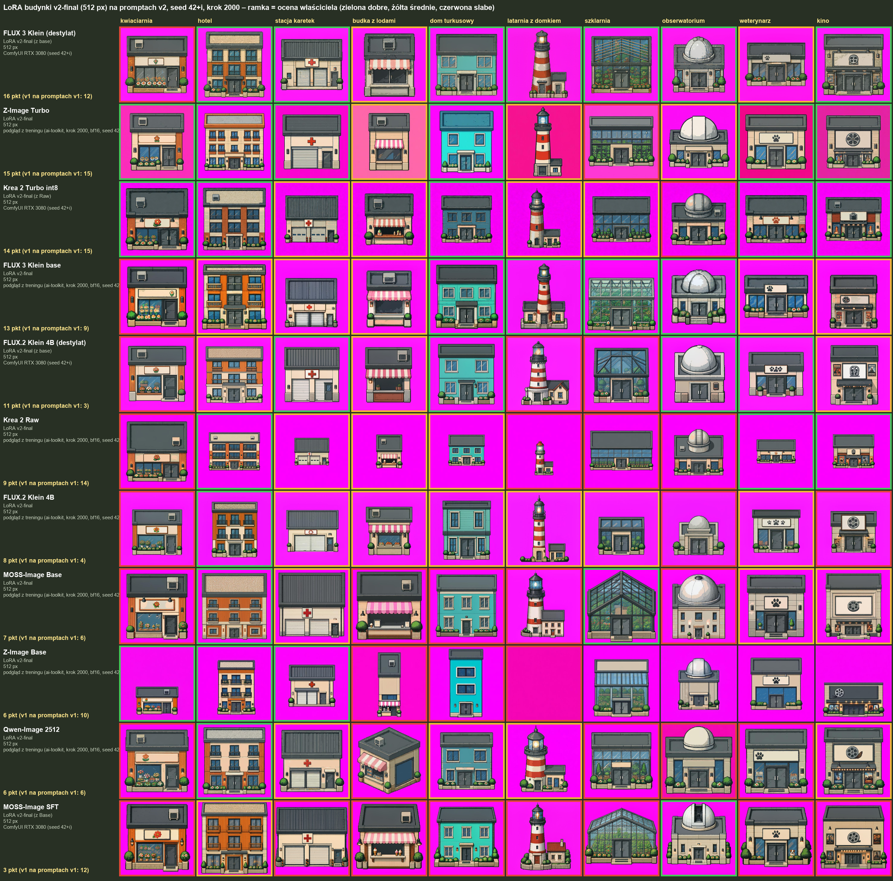

# LoRA v2-final na promptach v2 (2026-10-21)

- Wiersz: model bazowy + LoRA budynki v2-final (512 px). Kolumna: budynek testowy ([prompty v2](../../testy/prompty_v2.json)). Opisy LoRA: [`../../modele/v2/`](../../modele/v2/).
- Obrazy: podgląd z treningu (ai-toolkit, krok 2000, bf16, seed 42+i); lżejsze wersje modeli (MOSS SFT, destylaty FLUX, Krea 2 Turbo int8) – ComfyUI na RTX 3080, ten sam prompt i seed.
- Ramka = ocena właściciela (zielona dobre, żółta średnie, czerwona słabe). Punkty: dobre 2, średnie 1, słabe 0 (maks. 20).
- LoRA v2 uczona tylko w 512 px. Qwen-Image Q4 (GGUF) pominięty – lokalny plik to inny model niż 2512.

## Ranking

| # | model | LoRA | obraz | punkty | dobre | średnie | słabe | v1 · prompty v1 | v1 · prompty v2 | RTX 3080 / obraz |
|---|---|---|---|---|---|---|---|---|---|---|
| 1 | FLUX 3 Klein (destylat) | v2-final (z base) | ComfyUI RTX 3080 | **16** | 7 | 2 | 1 | 12 | 9 | 2.6 s |
| 2 | Z-Image Turbo | v2-final | podgląd z treningu (RunPod) | **15** | 6 | 3 | 1 | 15 | 12 | 15 s |
| 3 | Krea 2 Turbo int8 | v2-final (z Raw) | ComfyUI RTX 3080 | **14** | 5 | 4 | 1 | 15 | 12 | 8.2 s |
| 4 | FLUX 3 Klein base | v2-final | podgląd z treningu (RunPod) | **13** | 4 | 5 | 1 | 9 | 11 | 8.7 s |
| 5 | FLUX.2 Klein 4B (destylat) | v2-final (z base) | ComfyUI RTX 3080 | **11** | 4 | 3 | 3 | 3 | 6 | 3.1 s |
| 6 | Krea 2 Raw | v2-final | podgląd z treningu (RunPod) | **9** | 3 | 3 | 4 | 14 | 9 | za duży |
| 7 | FLUX.2 Klein 4B | v2-final | podgląd z treningu (RunPod) | **8** | 1 | 6 | 3 | 4 | 4 | 16 s |
| 8 | MOSS-Image Base | v2-final | podgląd z treningu (RunPod) | **7** | 2 | 3 | 5 | 6 | 1 | 7.8 s |
| 9 | Z-Image Base | v2-final | podgląd z treningu (RunPod) | **6*** | 3 | 0 | 3 | 10 | 0 | 33 s |
| 10 | Qwen-Image 2512 | v2-final | podgląd z treningu (RunPod) | **6** | 1 | 4 | 5 | 6 | 13 | za duży |
| 11 | MOSS-Image SFT | v2-final (z Base) | ComfyUI RTX 3080 | **3** | 1 | 1 | 8 | 12 | 11 | 7.7 s |

\* Z-Image Base: ocenione 6 z 10 obrazów.

Suma na tych samych 11 wierszach: **LoRA v2 + prompty v2: 108**, LoRA v1 + prompty v1: 106, LoRA v1 + prompty v2: 88.
Właściwe porównanie to v2/v2 vs v1/v1 (każda LoRA na promptach w stylu swojego zbioru) – wychodzi prawie remis. LoRA v1 na promptach v2 jest zaniżona, bo zbiór v1 nie miał rozmiarów w metrach w opisach.

Zmiany v1/v1 → v2/v2: w górę FLUX.2 Klein 4B destylat (+8), FLUX 3 Klein base (+4), FLUX 3 destylat (+4); w dół MOSS SFT (−9; LoRA uczona na Base, na SFT w v2 przenosi się gorzej), Krea 2 Raw (−5), Z-Image Base (−4, niepełne oceny).

## Budynki: które modele narysowały je dobrze

| budynek | dobre | średnie | słabe | oceniony jako „dobre” u |
|---|---|---|---|---|
| kwiaciarnia | 3 | 0 | 8 | Z-Image Turbo, Krea 2 Turbo int8, Z-Image Base |
| hotel | 8 | 3 | 0 | FLUX 3 Klein (destylat), Z-Image Turbo, Krea 2 Turbo int8, Krea 2 Raw, FLUX.2 Klein 4B, MOSS-Image Base, Z-Image Base, Qwen-Image 2512 |
| stacja karetek | 4 | 6 | 1 | FLUX 3 Klein (destylat), Z-Image Turbo, FLUX.2 Klein 4B (destylat), Z-Image Base |
| budka z lodami | 0 | 7 | 4 | – |
| dom turkusowy | 5 | 3 | 3 | FLUX 3 Klein (destylat), Z-Image Turbo, Krea 2 Turbo int8, FLUX 3 Klein base, FLUX.2 Klein 4B (destylat) |
| latarnia z domkiem | 2 | 4 | 5 | FLUX 3 Klein (destylat), FLUX 3 Klein base |
| szklarnia | 3 | 2 | 5 | FLUX 3 Klein (destylat), FLUX 3 Klein base, MOSS-Image Base |
| obserwatorium | 4 | 1 | 5 | FLUX 3 Klein (destylat), FLUX 3 Klein base, FLUX.2 Klein 4B (destylat), MOSS-Image SFT |
| weterynarz | 4 | 4 | 2 | Z-Image Turbo, Krea 2 Turbo int8, FLUX.2 Klein 4B (destylat), Krea 2 Raw |
| kino | 4 | 4 | 2 | FLUX 3 Klein (destylat), Z-Image Turbo, Krea 2 Turbo int8, Krea 2 Raw |

Względem v1 na tych samych promptach v2 najbardziej zyskały stacja karetek i hotel (poprawione drzwi na froncie i ciasny kadr), straciła latarnia (obiekt okrągły, takich nie ma w zbiorze).

Pliki: [`oceny.csv`](oceny.csv) – ocena każdego obrazu.
