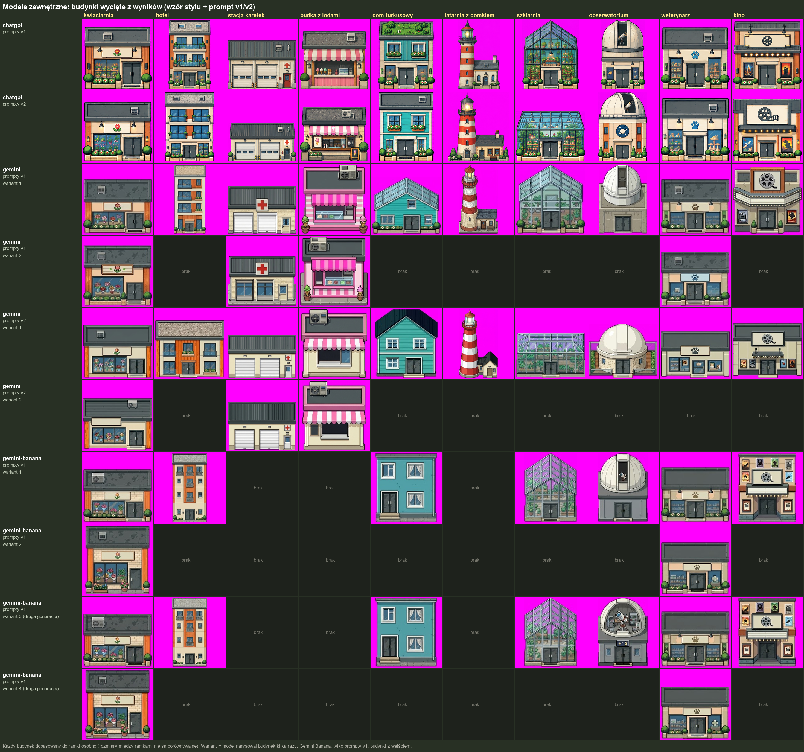

# Modele zewnętrzne: ChatGPT, Gemini, Gemini Banana (2026-10-21)

Jak zamknięte modele (bez trenowania, tylko z wzorem) rysują nasze 10 budynków testowych.

- **Wejście:** wzór stylu (+ wzór drzwi przy budynkach z wejściem) i jeden prompt „paskowy” na kilka budynków – pliki w [`../../testy/`](../../testy/). Prompty v1 i v2.
- **Wycinanie:** budynki wycięte z wyników do osobnych ramek; Gemini i Gemini Banana rysowały siatki z powtórzeniami, więc który wycinek jest którym budynkiem przypisano ręcznie. „Wariant” = ten sam budynek narysowany kilka razy.
- **Gemini Banana:** tylko prompty v1, tylko budynki z wejściem (dwie generacje).
- **Oryginały:** [`oryginaly/`](oryginaly/) – obrazy w takiej postaci, w jakiej zwróciły je modele; [`zestawienie_paski.png`](zestawienie_paski.png) – oryginały obok załączonych wzorów.
- Obrazy wygenerowane przez ChatGPT (OpenAI) i Gemini (Google), opublikowane jako wyniki testu.
