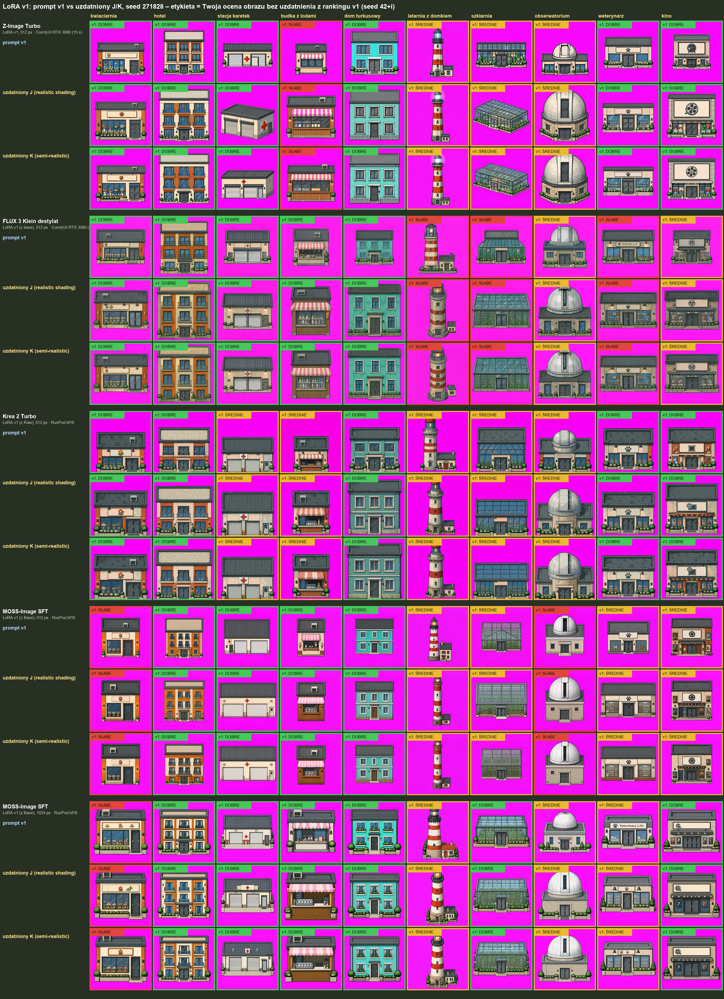
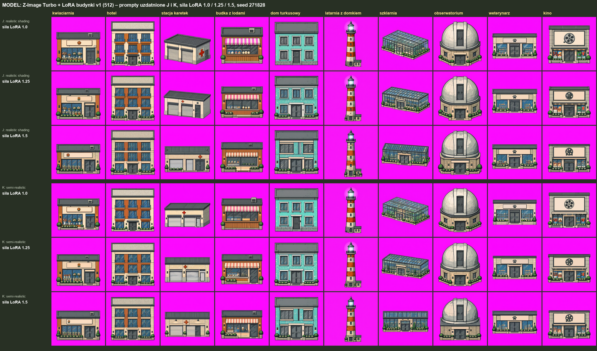
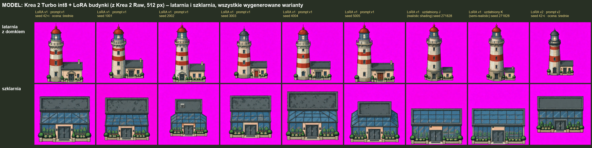

# Uzdatnione prompty J i K, siła LoRA (2026-10-21)

Ciąg dalszy testów [latarni i realizmu](../2026-10-21_lora-v1_prompty-v1/latarnia-i-realizm/): najlepsze warianty latarni (J, K) zastosowane do wszystkich 10 budynków testowych.
Uzdatnienie = prompt v1 + opis materiałów + hasło stylu, plus poprawki znanych błędów promptu v1 (drzwi stacji karetek na froncie, budka bez zaprzeczenia, latarnia jako wieża z domkiem obok, szklarnia z płaskim szklanym dachem z tafli w ramie). Prompty: [`prompty_J_K.txt`](prompty_J_K.txt).

- **J**: „Detailed pixel art game sprite with realistic shading and volume”
- **K**: „Semi-realistic pixel art game sprite”

Wszystko z **LoRA v1**, jeden nowy seed 271828.

## 5 modeli: prompt v1 vs J vs K

Etykieta na kafelku = ocena właściciela obrazu z rankingu v1 (prompt v1, seed 42+i), dla odniesienia.
Modele: Z-Image Turbo 512 i FLUX 3 Klein destylat 512 (ComfyUI RTX 3080), Krea 2 Turbo 512, MOSS-Image SFT 512 i 1024 (RunPod bf16).

Uwagi właściciela:
- MOSS-Image SFT: nadal złe drzwi i skośne dachy (LoRA uczona na Base, użyta na SFT).
- Krea 2 Turbo: stacja karetek bez poprawy.
- FLUX 3: dach zwęża się do tyłu (perspektywa) – w naszym rzucie dach to prostokąt tej samej szerokości co front.

## Z-Image Turbo: siła LoRA 1.0 / 1.25 / 1.5

Wyższa siła (1.5) przywraca front tam, gdzie „realistic” go rozmywał (stacja, szklarnia K). Latarnia przy wyższej sile nadal zła.

## Krea 2 Turbo int8: latarnia i szklarnia, wszystkie warianty

Kolumny: LoRA v1 + prompt v1 (seed 42+i i 5 nowych seedów), uzdatniony J i K (seed 271828), LoRA v2 + prompt v2. LoRA uczona na Krea 2 Raw; obrazy z Krea 2 Turbo int8 na RTX 3080, poza J i K (Krea 2 Turbo bf16 na RunPod).
- Latarnia: Krea rysuje ją poprawnie i powtarzalnie już bez uzdatnienia (pionowa wieża w paski, domek obok).
- Szklarnia: szklany dach (tafle w kratkę) tylko w J i K; bez uzdatnienia zawsze ciemny płaski dach nad szklanymi ścianami (także z LoRA v2).
- Dach prostokątny, bez zwężania do tyłu.
