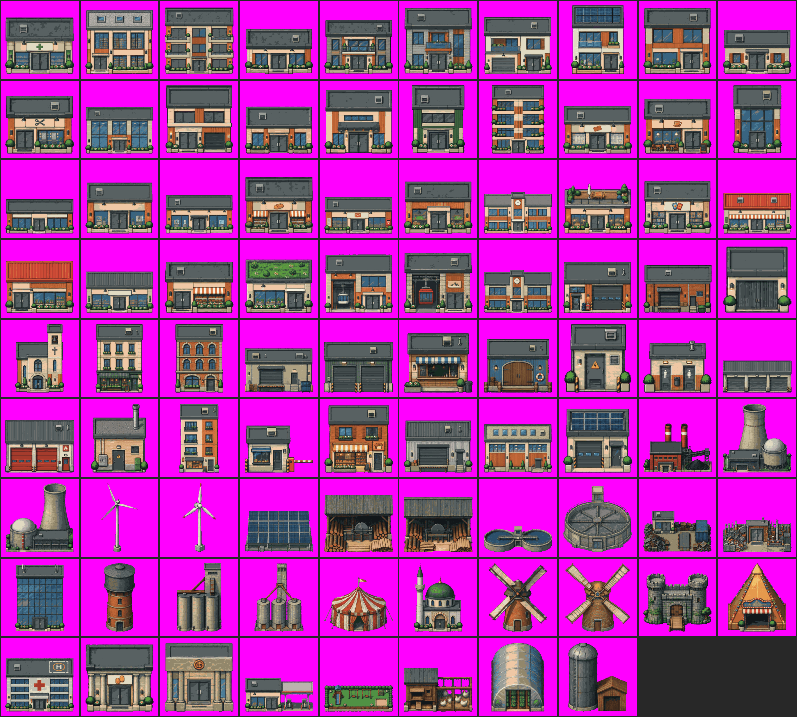

# Budynki: zbiór v3-final

Końcowy wybór właściciela, 2026-10-22: **88 obiektów** = 58 budynków z [v2-final](../v2-final/) + 30 nowych obiektów spoza dotychczasowego zbioru. **Tylko 512 px.**
Format jak v2: ciasny kadr (dłuższy bok 88% płótna, dół 6% nad krawędzią), tło magenta, rozmiar w metrach w opisie, kanoniczne drzwi w budynkach wejściowych.
Generator: [`narzedzia/budynki_pakiet_v3.py`](narzedzia/budynki_pakiet_v3.py). Lista zmian i powody: **[ZMIANY_V2_V3.md](ZMIANY_V2_V3.md)**.

## Zawartość
| folder / plik | co to jest |
|---|---|
| `train_512/` | `<nazwa>.png` (512 px, magenta #FF00FF) + `<nazwa>.txt` (opis) |
| `sprites/` | źródło w formacie gry (24 px = 1 m, paleta świata); budynki z v2 także `-open` |
| `metadata.jsonl` | nazwa, źródło (`v2-final` albo model + prompt + seed), typ, rozmiar, drzwi, opis, kadr 512 |
| `captions.csv` | wszystkie opisy |
| `narzedzia/` | skrypty: generowanie nowych obiektów, przeróbka do formatu gry, opisy, strony wyboru |

## Nowe obiekty (30)

Wygenerowane z LoRA budynki v2 (512) na 38 obiektach spoza zbioru, wybrane w dwóch etapach przez właściciela, potem przerobione jak budynki gry:
wycięcie z magenty → skala gry (wejściowe: drzwi = 58 px, dekoracyjne: szerokość z promptu) → paleta świata → kanoniczne drzwi std-external-2 wklejone w budynkach wejściowych → kadr v2.
Opisy napisane ręcznie według obrazu (nie według promptu generowania).

| nazwa | typ | rozmiar | źródło | prompt |
|---|---|---|---|---|
| `elektrownia-weglowa-1` | dekoracyjny | 24 × 17 m | MOSS-Image SFT + LoRA v2 | K (semi-realistic), seed 42+i |
| `elektrownia-atomowa-1` | dekoracyjny | 26 × 26 m | Krea 2 Turbo int8 + LoRA v2 | K, seed 2002 |
| `elektrownia-atomowa-2` | dekoracyjny | 26 × 26 m | Krea 2 Turbo int8 + LoRA v2 | K, seed 3003 |
| `turbina-wiatrowa-1` | dekoracyjny | 8 × 15 m | Krea 2 Turbo int8 + LoRA v2 | J (realistic shading), seed 42+i |
| `turbina-wiatrowa-2` | dekoracyjny | 8 × 17 m | MOSS-Image SFT + LoRA v2 | J (realistic shading), seed 42+i |
| `farma-fotowoltaiczna-1` | dekoracyjny | 16 × 10 m | FLUX 3 Klein destylat + LoRA v2 | K (semi-realistic), seed 42+i |
| `tartak-1` | dekoracyjny | 18 × 15 m | Krea 2 Turbo int8 + LoRA v2 | J (realistic shading), seed 42+i |
| `tartak-2` | dekoracyjny | 18 × 14 m | Krea 2 Turbo int8 + LoRA v2 | K (semi-realistic), seed 42+i |
| `oczyszczalnia-sciekow-1` | dekoracyjny | 20 × 8 m | Krea 2 Turbo int8 + LoRA v2 | K (semi-realistic), seed 42+i |
| `oczyszczalnia-sciekow-2` | dekoracyjny | 20 × 19 m | FLUX 3 Klein destylat + LoRA v2 | K (semi-realistic), seed 42+i |
| `skup-zlomu-1` | dekoracyjny | 14 × 8 m | Krea 2 Turbo int8 + LoRA v2 | K (semi-realistic), seed 42+i |
| `skup-zlomu-2` | dekoracyjny | 14 × 7 m | FLUX 3 Klein destylat + LoRA v2 | v2 (bez uzdatnienia), seed 42+i |
| `wiezowiec-szklany-1` | wejściowy | 11 × 15 m | Krea 2 Turbo int8 + LoRA v2 | J (realistic shading), seed 42+i |
| `wieza-cisnien-1` | dekoracyjny | 8 × 17 m | Krea 2 Turbo int8 + LoRA v2 | K (semi-realistic), seed 42+i |
| `silos-zbozowy-1` | dekoracyjny | 14 × 21 m | Krea 2 Turbo int8 + LoRA v2 | J (realistic shading), seed 42+i |
| `silos-zbozowy-2` | dekoracyjny | 14 × 19 m | FLUX 3 Klein destylat + LoRA v2 | K (semi-realistic), seed 42+i |
| `cyrk-1` | dekoracyjny | 16 × 13 m | FLUX 3 Klein destylat + LoRA v2 | J (realistic shading), seed 42+i |
| `meczet-1` | dekoracyjny | 16 × 22 m | Krea 2 Turbo int8 + LoRA v2 | K (semi-realistic), seed 42+i |
| `wiatrak-1` | dekoracyjny | 10 × 12 m | Krea 2 Turbo int8 + LoRA v2 | K (semi-realistic), seed 42+i |
| `wiatrak-2` | dekoracyjny | 10 × 11 m | FLUX 3 Klein destylat + LoRA v2 | K (semi-realistic), seed 42+i |
| `zamek-1` | dekoracyjny | 18 × 15 m | MOSS-Image SFT + LoRA v2 | J (realistic shading), seed 42+i |
| `piramida-wesole-miasteczko-1` | dekoracyjny | 12 × 14 m | Krea 2 Turbo int8 + LoRA v2 | K (semi-realistic), seed 42+i |
| `szpital-1` | wejściowy | 18 × 14 m | Krea 2 Turbo int8 + LoRA v2 | K (semi-realistic), seed 42+i |
| `bank-1` | wejściowy | 9 × 9 m | Krea 2 Turbo int8 + LoRA v2 | K (semi-realistic), seed 42+i |
| `bank-2` | wejściowy | 8 × 8 m | FLUX 3 Klein destylat + LoRA v2 | v2 (bez uzdatnienia), seed 42+i |
| `stacja-benzynowa-1` | wejściowy | 16 × 8 m | Krea 2 Turbo int8 + LoRA v2 | J (realistic shading), seed 42+i |
| `plac-zabaw-1` | dekoracyjny | 12 × 5 m | Krea 2 Turbo int8 + LoRA v2 | v2 (bez uzdatnienia), seed 42+i |
| `kurnik-1` | dekoracyjny | 7 × 4 m | Krea 2 Turbo int8 + LoRA v2 | K (semi-realistic), seed 42+i |
| `szklarnia-tunelowa-1` | dekoracyjny | 14 × 18 m | Krea 2 Turbo int8 + LoRA v2 | K (semi-realistic), seed 42+i |
| `silos-farma-1` | dekoracyjny | 10 × 12 m | Krea 2 Turbo int8 + LoRA v2 | K (semi-realistic), seed 42+i |

Prompty generowania: [`narzedzia/nowe_budynki_krea_v2_test2.py`](narzedzia/nowe_budynki_krea_v2_test2.py) (test-v2), nowe seedy: [`narzedzia/nowe_budynki_krea_k_seedy.py`](narzedzia/nowe_budynki_krea_k_seedy.py).

## Źródła obrazów
- 58 budynków z v2-final: obrazy ChatGPT przerobione przez nas (jak v1/v2).
- 30 nowych: wyniki modeli z naszą LoRA v2 – Krea 2 Turbo (Krea 2 Community License), FLUX 3 Klein (FLUX Kommunity License), MOSS-Image SFT (Apache 2.0). Przed użyciem komercyjnym trzeba sprawdzić warunki licencji tych modeli dotyczące wygenerowanych obrazów.
