# 2026-10-20: budynki, od pasków w ChatGPT do pierwszych LoRA

## Kontekst
Gra potrzebuje dużo budynków w jednym stylu: pixel art, kamera RPG 3/4, 24 px na metr, płaskie dachy. Ręczne rysowanie nie nadąża, a generowanie promptem daje za każdym razem trochę inny styl. Plan był taki: zebrać kilkadziesiąt dobrych budynków, wytrenować na nich LoRA i potem generować lokalnie w powtarzalnym stylu.

## 1. Paski z ChatGPT/Codex
Nowe budynki rysowaliśmy w ChatGPT: obrazek-wzór z zaakceptowanymi budynkami i miarką 1 m, a do tego prompt z listą 4 obiektów i ich wymiarami w metrach. Wynik to „pasek” z czterema budynkami na magencie.

Problemy, które wyszły po drodze:
- **Dachy ścięte i trapezowe.** Model rysował dach węższy u góry, czyli z perspektywą. Pomagała edycja w tej samej rozmowie, z dokładnym opisem prostokąta. Ta poprawka weszła do stałej procedury.
- **„Ulepszanie” szablonu szkodzi.** Gdy dopisywaliśmy do działającego promptu własne reguły, kolejne paski wychodziły gorzej. Od tego czasu szablon jest zamrożony i zmienia się tylko lista obiektów.
- **Słowa ciągną styl.** Pasek 15 z obiektami „town house”, „green shutters” i „brick” wyszedł jak europejska starówka, z cegłą, okiennicami i napisem „BAKERY”. Po przepisaniu listy naszymi materiałami (krem, pomarańczowe drewno, szare panele, piktogram chleba) pasek wrócił do stylu.

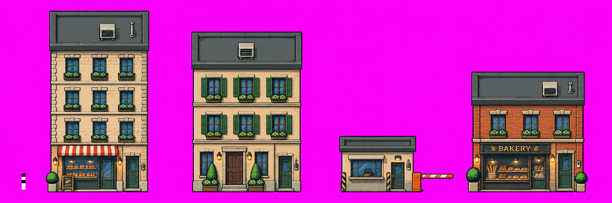
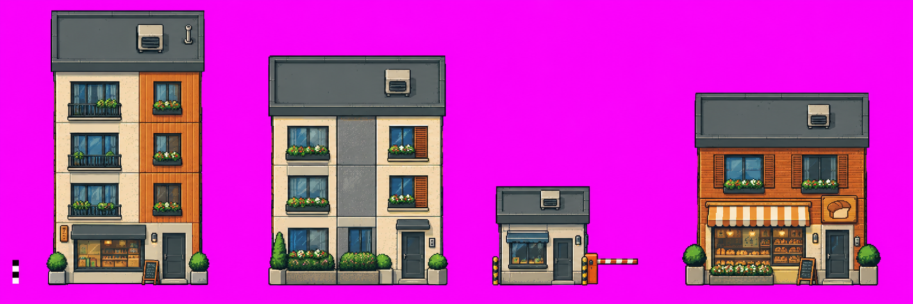

## 2. Drzwi: jeden kanoniczny moduł
Gra otwiera drzwi, podmieniając fragment sprite'a (wersja zamknięta i otwarta). Każdy budynek miał drzwi w innym rozmiarze i stylu, więc nie dało się tego zrobić spójnie. Próby wklejania drzwi z gry wyglądały „na sztywno”: inna faktura i kolory spoza filtra.

Decyzja: **drzwi narysowane przez ChatGPT w jednym budynku stają się kanonem** (59×58 px). Skrypt znajduje drzwi w każdym nowym budynku dopasowaniem wzorca, **skaluje cały budynek tak, żeby drzwi miały dokładnie 58 px**, a potem podmienia je na kanoniczne i liczy maskę otwarcia. Dzięki temu drzwi wyznaczają też skalę budynku. Drzwi mogą być poza środkiem frontu, a ich pozycję zapisujemy w opisie.

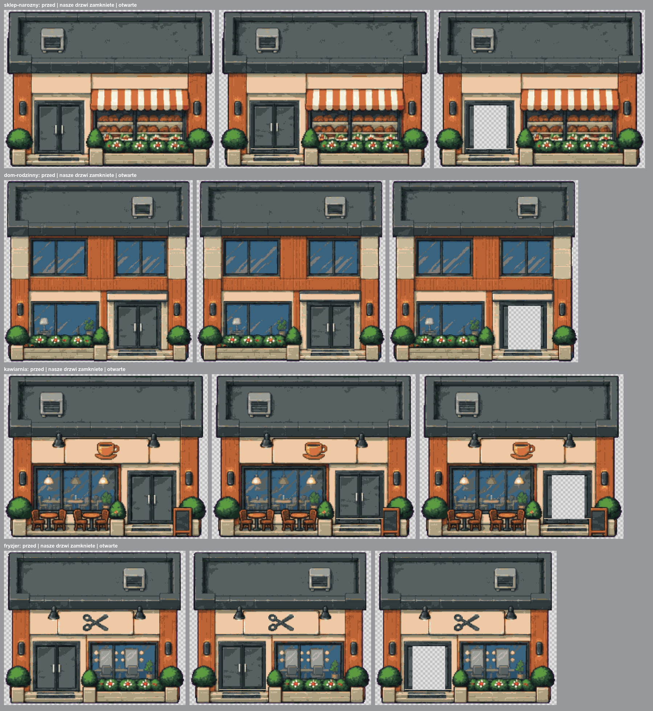

Budynki bez wejścia (garaże, magazyny, zajezdnia) są „dekoracyjne”: mają własne bramy, rysowane jako zamknięte.

## 3. Selekcja
Z 19 pasków i kilku starszych źródeł zostały 72 budynki: 47 z wejściem i 25 dekoracyjnych. Odpadły między innymi:
- budynki ze skośnym, przeszklonym wykuszem, bo uczyłyby model perspektywy, której nie chcemy (choć wyglądały dobrze);
- zajezdnia z uchylonymi bramami i wnętrzem w perspektywie;
- budynki z gry z innymi drzwiami i z napisem; do przerysowania naszym procesem.

Brakowało różnorodności dachów: wszystkie miały szarą papę z klimatyzatorem, bo tak wyglądał wzór. Dorobiliśmy paski z innymi pokryciami (blacha, żwir ze świetlikami, zielony dach, panele, taras). Dach nadal jest płaskim prostokątem, zmienia się tylko jego wierzch.

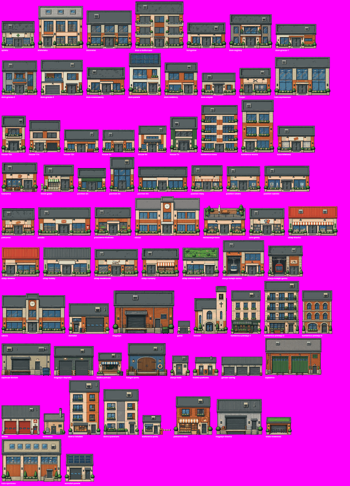

## 4. Opisy
Pierwsza wersja opisów była napisana z promptów, czyli z tego, o co prosiliśmy, a nie z tego, co wyszło. Przy przeglądzie wyszły rozjazdy (np. „stone and timber” przy budynku w kremie i drewnie) oraz powtórzenia. Wszystkie 72 opisy przepisaliśmy, patrząc na każdy obrazek, według jednego schematu. Na początku jest znacznik typu: `enterable building` albo `decorative building`. Usunęliśmy też „flower planters along the front”, bo donice to element stylu, który model ma dobierać sam.

Później znaleźliśmy jeszcze jedno zaprzeczenie („with no visible door”). Od tego dnia obowiązuje zasada zero zaprzeczeń.

## 5. Modele bez LoRA
Zanim trenowaliśmy, sprawdziliśmy, co modele robią same z tym samym opisem.

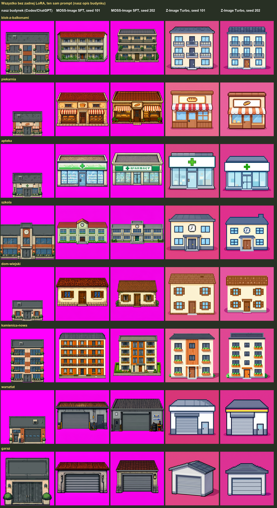

- **MOSS-Image SFT** (nowy, 5B, Apache 2.0) rysował ładnie, ale w swoim guście: spadzista dachówka, bajkowe kolory, a przy aptece napis z błędem.
- **Z-Image Turbo** rysował płasko, jak ikonki, na różowym tle.
- **MOSS-Image Base** rysował małe, proste budynki, za to sam z siebie z płaskim dachem.

Żaden nie trzyma naszego dachu, drzwi ani skali. To musi przyjść z LoRA.

## 6. Trening: 1024 czy 512
Pierwszy trening ruszył w 1024×1024 (sprite ×2). Szedł 7,5 s na krok, czyli ok. 4 h, bo karta 10 GB pracowała na granicy pamięci. Przerwaliśmy go i zrobiliśmy wariant **512×512 z pikselami gry ×1**: ten sam zbiór, ta sama wspólna skala, bez żadnego przeskalowania. Tempo spadło do 1,75 s na krok, a cały trening trwał 59 minut.

Uwaga do protokołu: przypuszczenie, że wcześniejszy trening w 512 dawał „rozmyte piksele”, okazało się niesprawdzone. Sprawdziliśmy tylko tyle, że stary zbiór miał obrazki różnych rozmiarów, przeskalowywane przez trener o niecałkowity współczynnik. Nowe zbiory mają stały rozmiar płótna, więc tego problemu nie mają.

## 7. LoRA: Z-Image Turbo i MOSS-Image Base
Oba treningi szły na tym samym `train_512`: 2000 kroków, lr 1e-4, rank 16. Podglądy liczyły się na 4 budynkach **spoza** zbioru: kwiaciarnia, hotel, stacja karetek i budka z lodami.

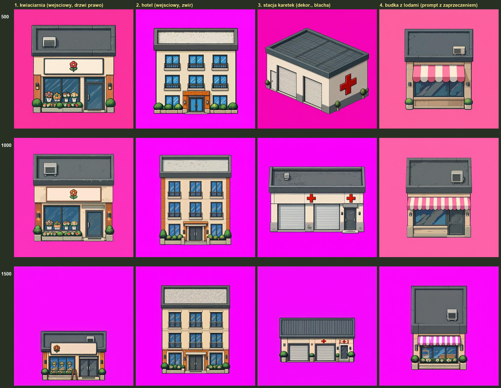

- **Z-Image Turbo** (59 min): przy kroku 500 stacja karetek była jeszcze w izometrii, a tło różowe. Przy 1500–2000 wszystko stoi frontem, na wspólnej linii gruntu, z naszymi dwuskrzydłowymi drzwiami i pokryciem dachu zgodnym z opisem. Krok 2000 jest stabilny.
- **MOSS-Image Base** (48 min): uczył się szybciej. Czystą magentę i skalę miał już przy kroku 500, a przy 1000 wyprostował kamerę. Przy kroku 2000 zaczął się psuć: malał budynki, a jeden obrazek wyszedł pusty. To przeuczenie, więc na Base najlepsze są kroki 1000–1500.

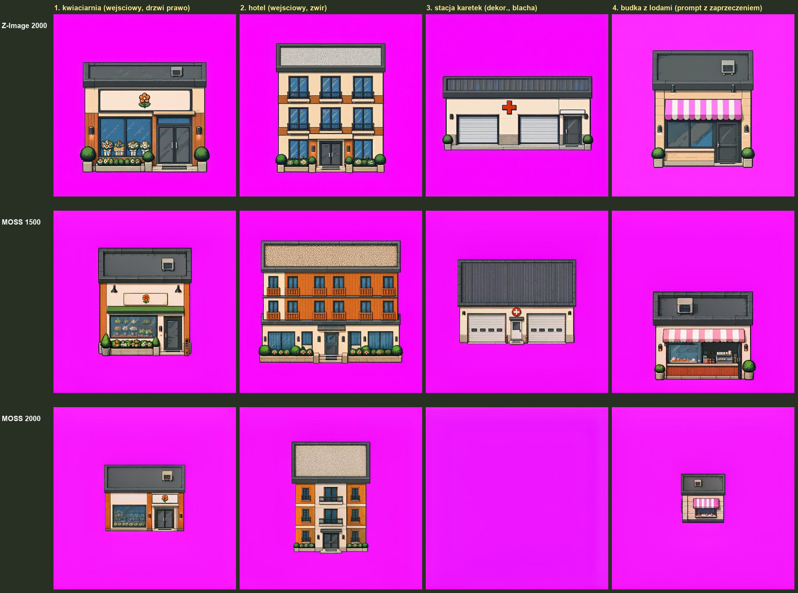

**Najciekawszy wynik dnia:** LoRA wytrenowana na MOSS **Base**, podpięta pod MOSS **SFT**. SFT bez LoRA rysuje w izometrii i w swoich kolorach, a z naszą LoRA stoi frontem, w naszej palecie i z największą ilością detali ze wszystkich wariantów. Przy kroku 1500 dachy jeszcze lekko się zwężały, przy 2000 są już prostymi prostokątami. Ta sama LoRA, która na Base przy kroku 2000 się psuje, na SFT daje najlepszy wynik.

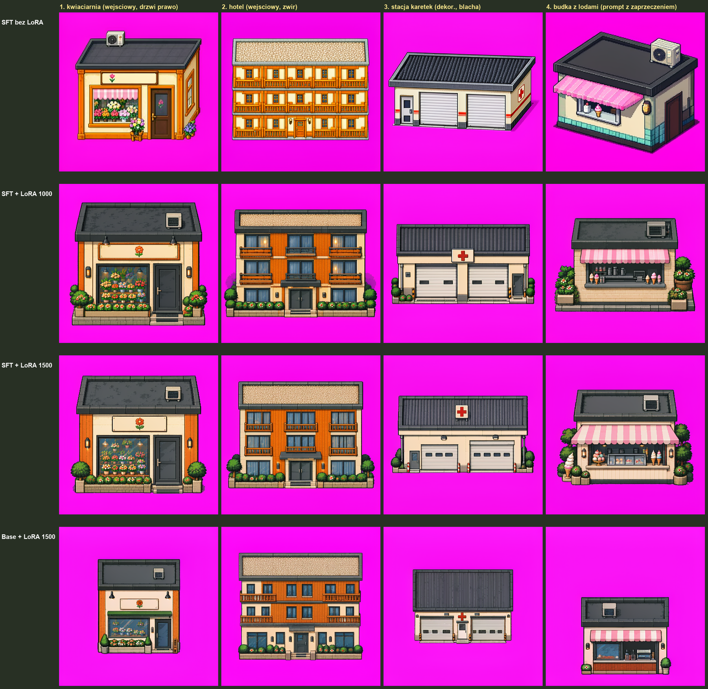
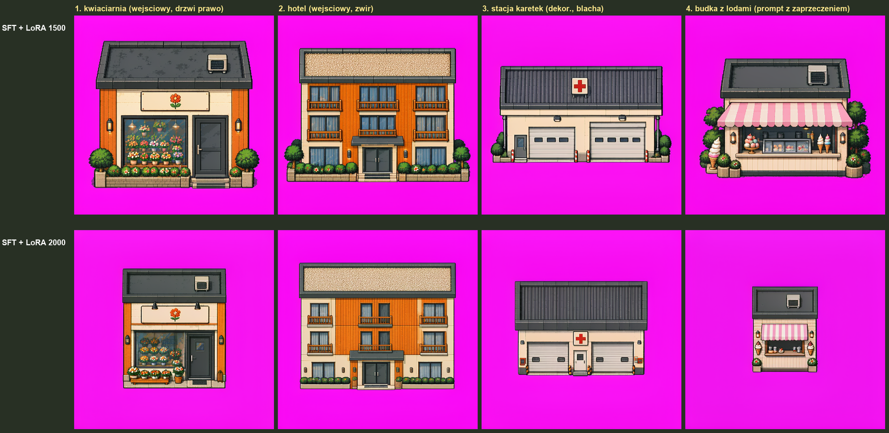

## 8. FLUX 3 Image Klein: pierwszy kontakt
Tydzień wcześniej Black Forest Labs wypuściło FLUX 3 Image Klein (5,5B, licencja FLUX Kommunity). To jeden model do generowania i do edycji z obrazkiem-wzorem. ComfyUI i ai-toolkit już go obsługują.

- Sam tekst: ładny pixel art, ale w swoim stylu (dach czterospadowy, izometria, różowe tło).
- **Tekst ze wzorem, jak w ChatGPT:** pasek z 4 budynkami w naszym stylu, z kanonicznymi drzwiami, płaskimi dachami, a nawet z miarką. Lokalnie, w ok. 30 s.
- Wada: przy pojedynczym budynku model przepisuje treść ze wzoru. Kwiaciarnia wyszła jako apteka, a budka z lodami jako piekarnia.

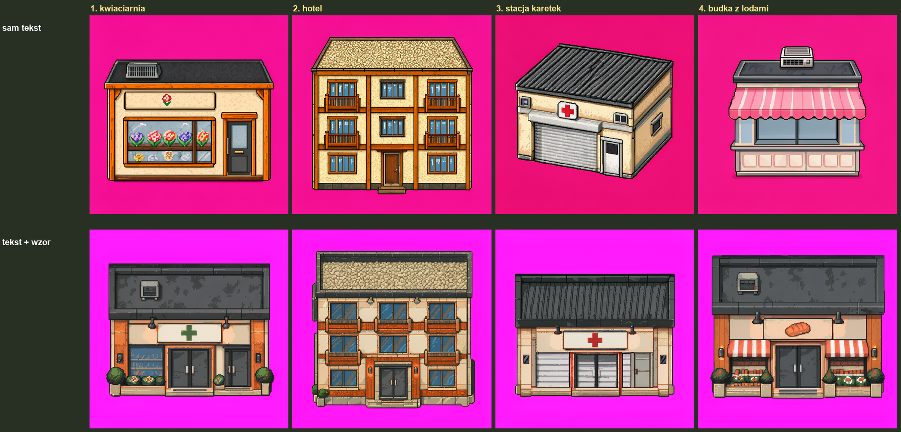
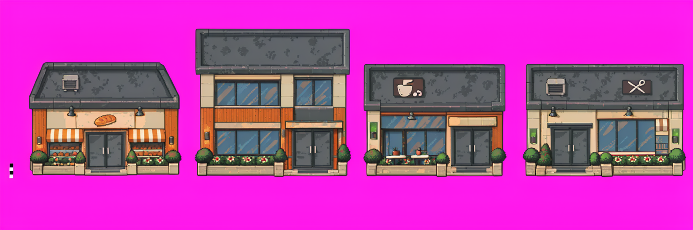

## 9. Tył i bok budynku
Do gry kiedyś przydadzą się widoki z innych stron. Wcześniej FLUX.2 klein 9B robił poprawne tyły, ale boki wychodziły zawsze w izometrii. FLUX 3 w trybie edycji, z frontem jako wzorem, **narysował wąską, prostą ścianę boczną w 5 z 6 prób**. Tyły wyszły podobnie jak w klein 9B, który nieco lepiej trzyma materiały.

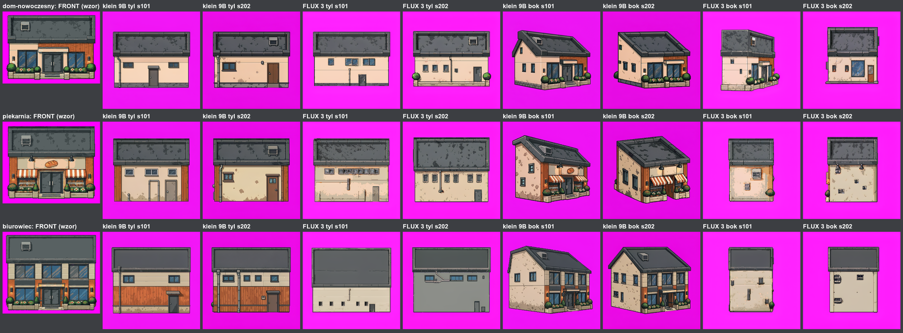

## Decyzje dnia
- Zbiór `lora-budynki-v1-final` (72 budynki) zaakceptowany i w repo, w dwóch wariantach płótna: 512 i 1024.
- Trenujemy w 512 z pikselami ×1: ponad 6 razy szybciej, bez przeskalowań.
- Zero zaprzeczeń w opisach i promptach.
- W repo: LoRA Z-Image (krok 2000) oraz LoRA MOSS (1500 na Base, 2000 na SFT).

## Błędy i wnioski
- Prompt testowy budki z lodami miał zaprzeczenie, więc ten test był niemiarodajny. Wyłapaliśmy to dopiero w trakcie treningu.
- Przy zatrzymywaniu treningu zabijaliśmy tylko proces główny, a procesy ładujące dane zostawały w tle. Trzeba kończyć całe drzewo procesów.
- Podglądy z ai-toolkit są w JPG, więc ostrość pikseli oceniamy dopiero w PNG z ComfyUI.

## Następne kroki
- LoRA na FLUX 3 Klein base, na tym samym zbiorze. Z LoRA wzór nie powinien być potrzebny, więc nie będzie też kopiowania treści ze wzoru.
- Porównanie w PNG na kilku seedach: Z-Image, MOSS SFT i FLUX 3, wszystkie z LoRA.
- Natura: ten sam proces, ale z własną kamerą dla roślin (okrągłe korony, płaski wierzch tylko u żywopłotów i rabat).
