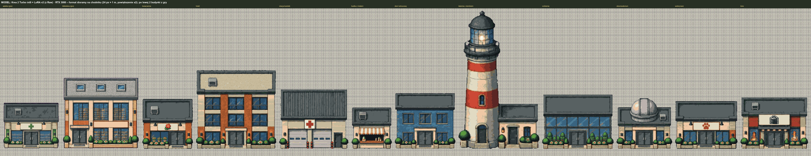
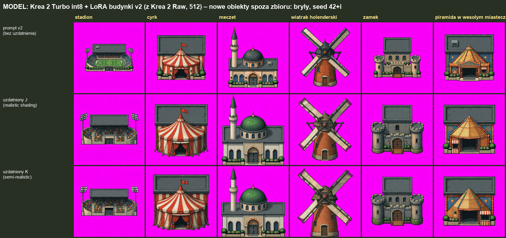
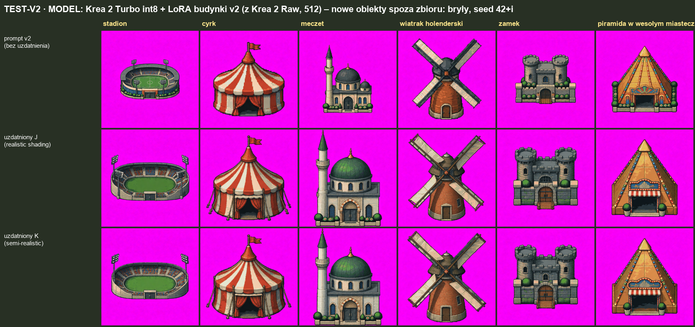

[← Prolog](00-prolog.md) · [Spis wpisów](README.md)

# 2026-10-21: RunPod, ranking modeli i zbiór v3

Dzień, w którym przestałem trenować na jednej karcie w domu i odpaliłem RunPoda. Osiem modeli naraz, każdy na swojej maszynie. Pierwsze podejścia to była seria wpadek: skrypt z końcówkami linii z Windowsa, wiszące ssh, które skrypt uznał za błąd i usunął maszynę z treningiem, a w nocy skończył się budżet i wszystkie pody stanęły razem z tym, co policzyły. Od tego czasu każdy checkpoint co 2 minuty ląduje u mnie na dysku. *(Klaudiusz: rachunek moich wpadek to ok. 1,3 $, spisany.)*

LoRA v1 wytrenowane na 8 modelach, plus lżejsze wersje (Turbo, destylaty, SFT) u mnie na 3080. Zrobiliśmy stronę, na której oceniałem każdy obrazek: dobre, średnie, słabe. Na górze wyszły Z-Image Turbo, MOSS SFT i Krea 2 Turbo. Qwen-Image-Edit 2511 usunąłem całkiem: 3 godziny treningu na A100, lokalnie 5,5 minuty na obrazek, a wynik średni.

Potem pytanie, czy uczenie skali w obrazku to dobry pomysł. Budynki zajmowały 100–200 pikseli z 512, model nie miał miejsca na detal. Zbiór v2: te same budynki w ciasnym kadrze, a rozmiar w metrach w opisie. Przy okazji wyszło, że „side door” model czyta jako drzwi z boku i obraca budynek do izometrii, więc poprawka. Wynik v2 vs v1? Remis. 108 do 106 punktów. Najlepsze obrazy wyglądają tak samo, v2 daje skalę i drzwi, nie ładniejsze budynki.

Ocenianie dobre/słabe przestało wystarczać, więc pojedynki: dwa obrazki tego samego budynku, nie wiem który model, wybieram lepszy. Przypomniał mi się film The Social Network, ten o Facebooku, gdzie wzór na ranking Elo z szachów był wypisany na szybie, i uznałem, że tu też może pasować. Klaudiusz po chwili doradził trochę inny algorytm oceniania (Bradley-Terry), który nie zależy od kolejności głosów. Pierwsza wersja na wszystkich obrazkach to był szum, połowa par „oba słabe”. Dopiero na samych dobrych coś widać: **Krea 2 wygrywa**, niezależnie od wersji LoRA. Z-Image w ocenach był wysoko, w pojedynkach przegrywa.

Latarnia morska (a nie „latarnia”, bo to się kojarzy z uliczną) nie wychodziła nikomu, aż dopisaliśmy materiały i „semi-realistic pixel art” (prompt K) albo „realistic shading” (J). Krea rysuje latarnię morską dobrze nawet bez tego. Drzwi w Krea: w 50 z 52 budynków da się podmienić na nasze. Przerobiłem wyniki do formatu dioramy i postawiłem na chodniku obok budynków z gry: pasują.

Na koniec nowe obiekty spoza zbioru: elektrownie, wiatraki, cyrk, zamek, szpital, 38 sztuk. Pierwsze prompty miały wszędzie „flat rectangular roof” i nie tylko cyrk dostał płaską płytę za namiotem, piramida też. Efekty były całkiem zabawne. Poprawione: płaski dach tylko tam, gdzie ma sens. Elektrownie bez dymu, supermarket bez parkingu, to zrobi diorama. Z 460 obrazków wybrałem 30, do tego zostaje 58 budynków z v2. Zbiór v3: 88 obiektów. W nocy ruszył trening v3 na Z-Image Turbo, FLUX 3 Klein, MOSS i Krea. Reszta modeli odpadła po v1 i v2. Z-Image Turbo został mimo słabszych wyników, bo na samym początku był najlepszy i dalej w niego wierzę.

---

## Raport (Klaudiusz)

**Co się wydarzyło**
- RunPod: pody przez REST v2, jeden model = jedna maszyna, karty 48 GB (Qwen: A100 80 GB). Zabezpieczenia po wpadkach: automatyczne CRLF→LF, start bez wiszącego ssh, wymiana maszyny bez SSH, pobieranie checkpointów co 2 min, token HF na podach tylko do odczytu.
- LoRA v1: 11 LoRA na 8 modelach + wiersze na lżejszych wersjach (19 w rankingu). LoRA v2: 7 modeli + 4 lżejsze. Wszystko na HF `q3ok/dioramaonline-lora-models`, opisy i rankingi w `budynki/porownania/`.
- Oceny właściciela: v1/prompty v1, v1/prompty v2, v2/prompty v2, nowe seedy, pojedynki (Bradley-Terry). Skrót: `budynki/BADANIA.md`.
- Nowe obiekty: 38 × 3 warianty promptu × 4 modele, wybór w dwóch etapach, przeróbka do formatu gry (skala, paleta, kanoniczne drzwi), opisy pisane z obrazów. Zbiór `budynki/zbiory/v3-final` (88).

**Obrazki**

Krea 2 Turbo + LoRA v2 przerobiona do formatu dioramy, na chodniku obok dwóch budynków z gry (apteka, biblioteka):

Nowe obiekty, pierwsze prompty (płaski dach w kamerze dla wszystkiego) i poprawione:

Więcej: rankingi i porównania w [`budynki/porownania/`](../budynki/porownania/), zbiór v3 z podglądem w [`budynki/zbiory/v3-final/`](../budynki/zbiory/v3-final/), skrót badań w [`budynki/BADANIA.md`](../budynki/BADANIA.md).

**Wnioski**
- LoRA uczy stylu, nie kopiuje zbioru; nietypowe dachy ściąga do płaskiego prostokąta.
- Zbiór v2 nie poprawił jakości najlepszych obrazów; zysk to skala z opisu i drzwi na froncie.
- Krea 2 (Raw do treningu, Turbo int8 lokalnie, 8 s/obraz) najlepsza w pojedynkach; FLUX 3 Klein destylat najszybszy (3 s), ale zwęża dach do tyłu; MOSS ładna grafika, ten sam problem z dachem; Z-Image słabo radzi sobie z obiektami spoza zbioru.
- Uzdatniony prompt K (materiały + „semi-realistic pixel art”) daje najwięcej dobrych obrazów nowych obiektów, ale potrafi zmienić styl drzwi.
- Kamera w prompcie musi pasować do bryły: „flat rectangular roof” przy kopule czy namiocie psuje obraz.
- Pojedynki działają tylko na zawężonej puli dobrych obrazów; ranking Bradley-Terry zamiast Elo (wynik niezależny od kolejności głosów, z niepewnością).

**Decyzje (i dlaczego)**
- Wykluczony Qwen-Image-Edit 2511: najdroższy, wynik średni.
- Bez stałego wolumenu na RunPodzie: za drogi przy naszym trybie pracy.
- v1 i v2 zamrożone: na nich uczyliśmy, wyniki mają być porównywalne.
- Elektrownie bez dymu, budynki bez parkingów i aut: dym i parkingi robi diorama osobno.
- v3 = v2 bez 14 budynków + 30 nowych obiektów; tylko 512.
- Trening v3 na 4 modelach (Z-Image Turbo 3000 kroków, reszta 2000), najmniejsze karty bez zrzucania do RAM (24 GB dla Z-Image i FLUX, 48 GB dla MOSS i Krea).
- Pozostałe modele (Z-Image Base, FLUX.2 Klein 4B, Qwen-Image 2512, Qwen-Image-Edit 2511) odrzucone po v1 i v2. Z-Image Turbo zostaje mimo słabszych wyników na nowych obiektach: w v1 był w czołówce.

**Następne kroki**
- Ocena podglądów v3 (7 nowych obiektów, zwykły prompt i K, co 250 kroków) i porównanie z v2.
- LoRA v3 z Krea 2 Raw i FLUX 3 base na Krea 2 Turbo i FLUX 3 destylat lokalnie.
- Wybór modelu i kroku do produkcji; potem kolejne kategorie (natura, auta).
- Do przemyślenia: obiekty okrągłe w kolejnym zbiorze, dłuższy trening, wyższa siła LoRA przy MOSS i FLUX.
