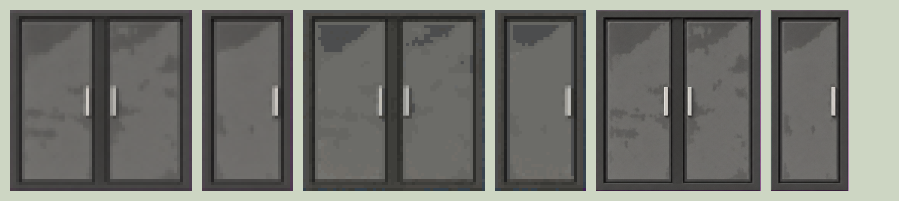

# Drzwi kanoniczne (v7, od 2026-10-23)

Nasza podstawa: jedyne drzwi, których używamy w budynkach Świata 2D. Na razie **tylko drzwi zamknięte** (otwarte nie są zdefiniowane). Wcześniejsze wersje (v4–v6) są nieużywane.

| moduł | rozmiar w grze | wymiar | doorway (x, y, w, h) |
|---|---|---|---|
| `std-external-2` (dwuskrzydłowe) | 60 × 60 px | 2,5 × 2,5 m, kwadrat | 10, 3, 42, 57 |
| `std-external-1` (jednoskrzydłowe) | 30 × 60 px | 1,25 × 2,5 m | 4, 4, 22, 56 |

Pliki (`<typ>` = `2skrz` / `1skrz`):

| plik | co to jest |
|---|---|
| `drzwi-<typ>-closed_pelny.png` | rozmiar gry, pełny kolor – źródło do dowolnej palety |
| `drzwi-<typ>-closed_p1024.png` | rozmiar gry, paleta 1024 (128 + kolory pośrednie) |
| `drzwi-<typ>-closed_master_pelny.png` | bez zmniejszenia: wycinek z gpt-image-2 (2-skrz 468×516, 1-skrz 221×516), pełny kolor |
| `drzwi-<typ>-closed_master_p1024.png` | bez zmniejszenia, paleta 1024 |

Skala gry 24 px/m, więc 2,5 m = dokładnie 60 px. Master nie jest dokładnym kwadratem (GPT narysował drzwi ok. 10% wyższe); wersja w rozmiarze gry jest skalowana do dokładnie 60×60 / 30×60. Dane: [`drzwi_kanon_v7.json`](drzwi_kanon_v7.json).

Pochodzenie: projekt v6 (v4 59×57 → v5 kwadrat 59×59 → v6 60×60), przerysowany przez gpt-image-2 (quality high) w pełnym kolorze; prompt: zachowaj projekt, szare szkło z plamami, kwadrat 1:1.

