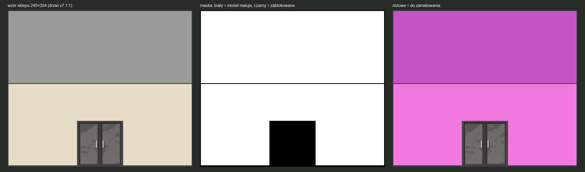

# Maska sklepu jednopiętrowego (od 2026-10-23)

Wzór do inpaintingu budynku jednopiętrowego w wymiarach sklepu: **10 m szerokości, 8 m głębokości, front 4,5 m**. Model maluje tylko dach i ścianę, a geometria i drzwi są narzucone kodem.

| element | piksele (1:1, skala 24 px/m) |
|---|---|
| sprite | 240 × 204 |
| dach (głębokość 8 m × 12 px/m, rzut ½) | wiersze 0–95, linia okapu = wiersz 95 |
| front (4,5 m) | wiersze 96–203 (108 px) |
| cokół (podstawa, bez podłoża) | wiersze 202–203 |
| drzwi v7 dwuskrzydłowe 60×60 ([`../../drzwi/`](../../drzwi/)), `drzwi-2skrz-closed_pelny.png` 1:1 | x 90–149, y 144–203 (środek, na podstawie) |

Kolory tła wzoru (ściana, dach, obrys, cokół) z palety 1024. Maska: **biały = model maluje** (dach i ściana, ok. 90% sprite'a), **czarny = zablokowane**: drzwi, obrys 1 px, linia okapu (żeby model nie przesuwał granicy dach/front) i cokół 2 px (żeby nie dorysowywał podłogi).

| plik | do czego |
|---|---|
| `sklep_240x204_wzor.png`, `sklep_240x204_maska.png` | wersja 1:1 |
| `sklep_wejscie_1024.png`, `sklep_maska_1024.png` | wejście dla modelu: wzór ×4 (960×816) na płótnie 1024×1024 #FF00FF, budynek x 32–991, y 104–919; maska w tej samej skali, tło poza budynkiem zablokowane (ComfyUI: biały = maluj) |
| `sklep_maska_openai_1024.png` | to samo dla OpenAI `images.edit`: przezroczyste = do zamalowania |

Po inpaintingu: wynik składamy z wzorem przez maskę (zablokowane piksele zostają co do piksela), wycinamy budynek, zmniejszamy ×4 (BOX) do 240×204, mapujemy na paletę i wklejamy drzwi v7 1:1.

